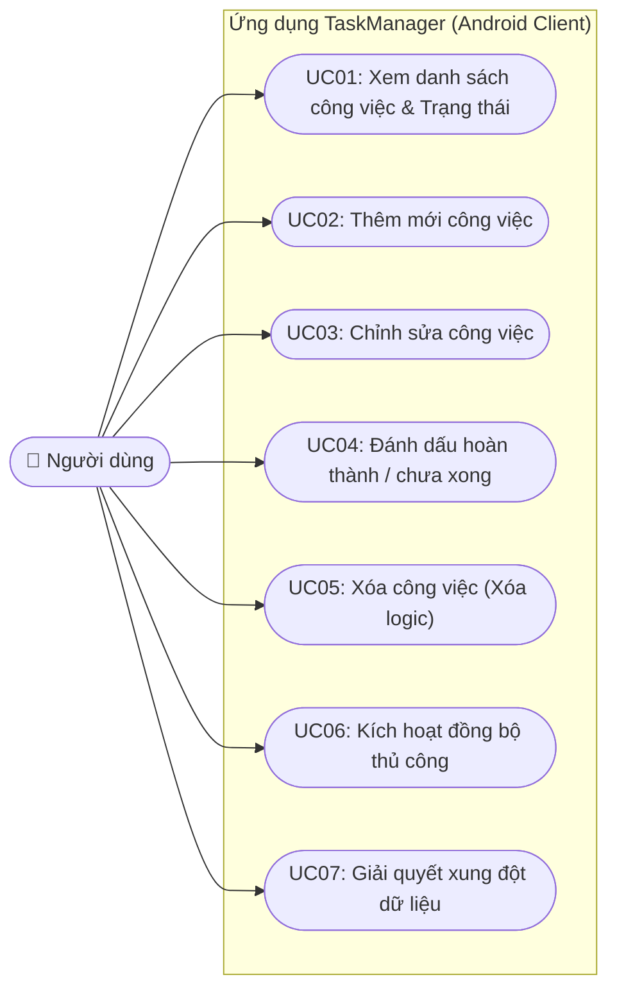
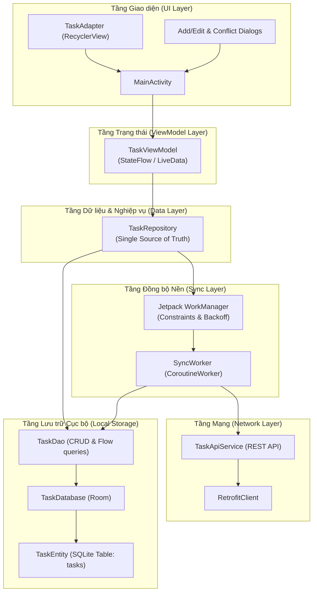
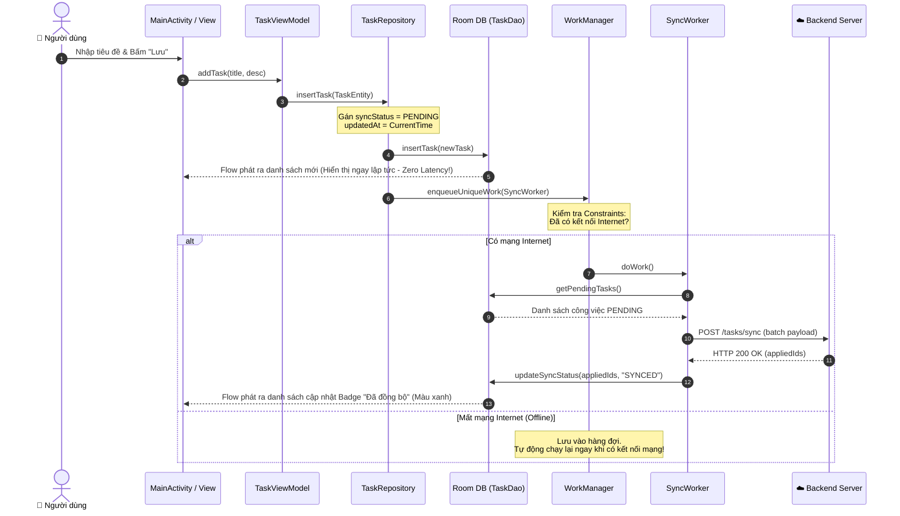
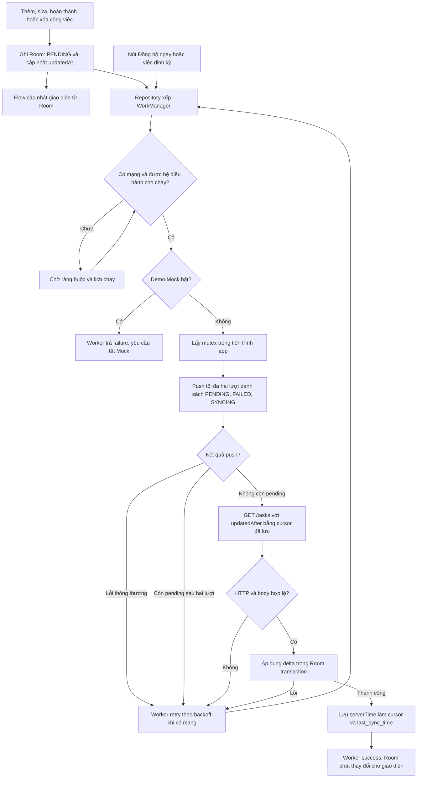
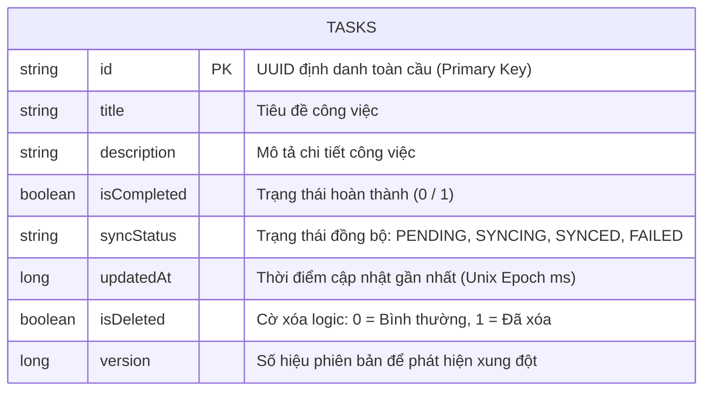
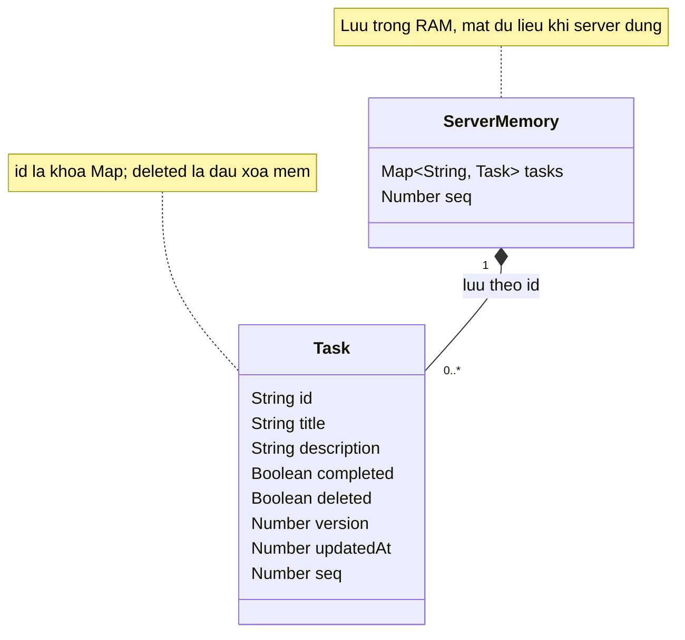

# TÀI LIỆU PHÂN TÍCH THIẾT KẾ (DELIVERABLE D2 - PHẦN NGƯỜI A)
**Đề tài**: Xây dựng Ứng dụng Quản lý Công việc Hỗ trợ Đồng bộ Tự động (Offline-First Task Manager)  
**Người phụ trách**: Người A (Android Client Lead)  

---

## 1. SƠ ĐỒ CA SỬ DỤNG PHÍA CLIENT (USE CASE DIAGRAM)

### Bảng đặc tả các ca sử dụng chính:
- **UC01: Xem danh sách**: Người dùng mở ứng dụng, danh sách công việc hiển thị ngay từ Room DB kèm badge trạng thái đồng bộ (`SYNCED`, `PENDING`, `SYNCING`, `FAILED`).
- **UC02: Thêm mới công việc**: Nhập tiêu đề, mô tả. Dữ liệu được gán UUID, lưu vào Room với `syncStatus = PENDING`, kích hoạt WorkManager.
- **UC03: Sửa công việc**: Cho phép cập nhật tiêu đề, mô tả. Trạng thái chuyển thành `PENDING`, cập nhật timestamp `updatedAt`.
- **UC04: Hoàn thành / Chưa xong**: Tích chọn checkbox, cập nhật trạng thái `isCompleted` trong Room.
- **UC05: Xóa công việc**: Đánh dấu `isDeleted = 1`, ẩn khỏi UI, giữ lại để gửi Tombstone lên server.
- **UC06: Đồng bộ thủ công**: Bấm nút "Đồng bộ ngay" để gọi `enqueueUniqueWork` chạy ngay lập tức.
- **UC07: Giải quyết xung đột**: Khi phát hiện dữ liệu trên server có phiên bản mới hơn phiên bản cơ sở (Base Version), hiển thị dialog so sánh hai phiên bản để người dùng chọn.

---

## 2. SƠ ĐỒ THÀNH PHẦN CLIENT (COMPONENT DIAGRAM)

---

## 3. SƠ ĐỒ TUẦN TỰ: LUỒNG THÊM CÔNG VIỆC VÀ TỰ ĐỘNG ĐỒNG BỘ (SEQUENCE DIAGRAM)

## 4. SƠ ĐỒ LUỒNG TỔNG THỂ:

- Push trước, pull sau; một lượt push có thể gồm nhiều task, không phải chỉ một HTTP request.
- Khi PUT thành công, engine chỉ đánh dấu SYNCED nếu local còn khớp snapshot gửi đi; nếu đã sửa tiếp thì giữ PENDING và cập nhật version cơ sở.
- Khi pull: chèn ID chưa có; thay bản local SYNCED nếu version server không nhỏ hơn; giữ lại bản local đang chờ đồng bộ.
- Lỗi pull không tiến cursor, nhưng các task đã được PUT xác nhận vẫn có thể SYNCED.
- Mutex chỉ tuần tự hóa các phiên trong cùng tiến trình app. Cancellation được chuyển lại cho WorkManager, không đi qua nhánh retry lỗi thông thường trong sơ đồ

---

## 5. THIẾT KẾ CƠ SỞ DỮ LIỆU CỤC BỘ ROOM (ERD)

### Bảng: `tasks`

---

## 6. THIẾT KẾ CƠ SỞ DỮ LIỆU SERVER (ERD)

### Mô tả chi tiết các ràng buộc và chỉ mục:
1. **Khóa chính (`id`)**: Dùng kiểu chuỗi `UUID.randomUUID().toString()`, đảm bảo tính duy nhất trên nhiều thiết bị mà không cần chờ Server cấp phát ID tự tăng.
2. **Cờ `isDeleted`**: 
   - Mặc định là `false` (`0`).
   - Khi xóa: Chuyển sang `true` (`1`).
   - Truy vấn hiển thị: `WHERE isDeleted = 0`.
3. **Cột `syncStatus`**:
   - `PENDING`: Cần đẩy lên server khi có mạng.
   - `SYNCING`: Đang trong tiến trình đẩy dữ liệu.
   - `SYNCED`: Đã đồng bộ thành công và trùng khớp với server.
   - `FAILED`: Lỗi mạng hoặc từ chối từ server.
4. **Cột `version`**:
   - Khởi tạo ban đầu là `1L`. Mỗi lần người dùng cập nhật hoặc giải quyết xung đột, giá trị này được tăng lên để hỗ trợ kỹ thuật Optimistic Concurrency Control.
