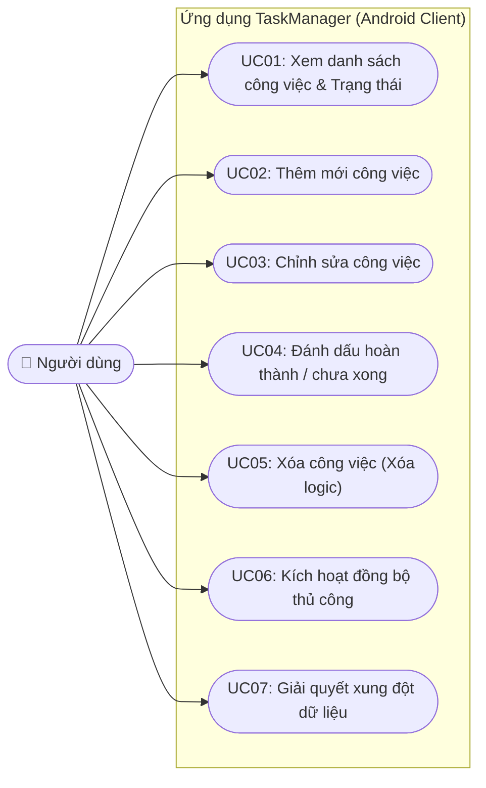
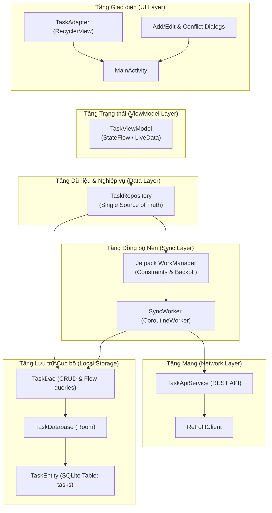
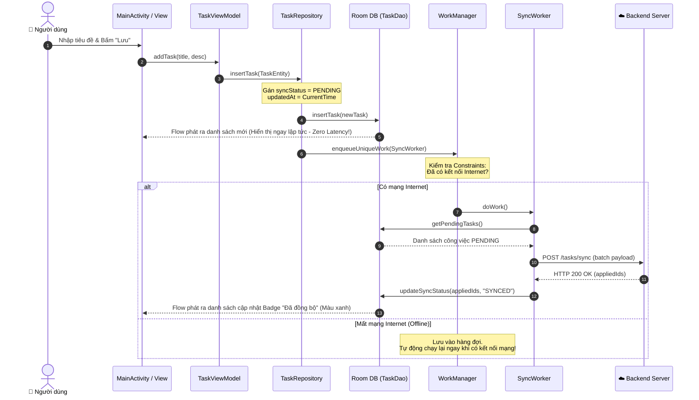
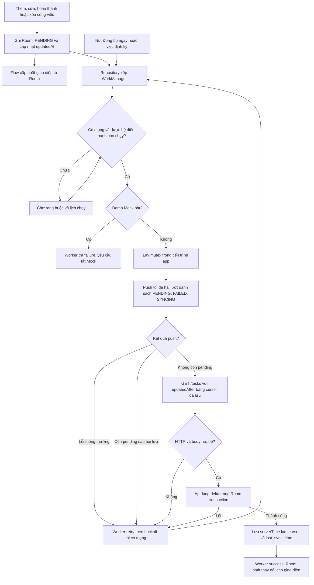
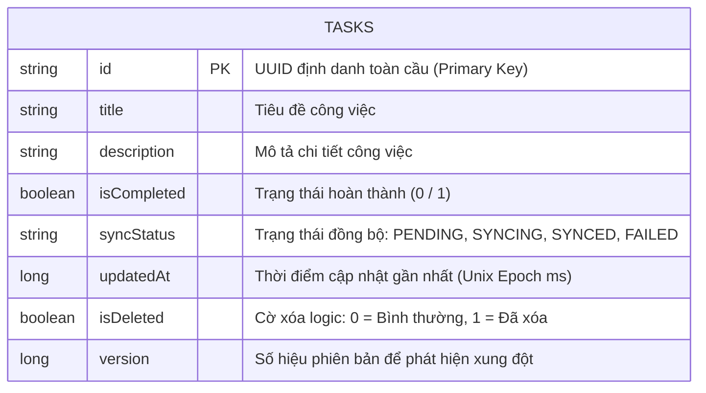
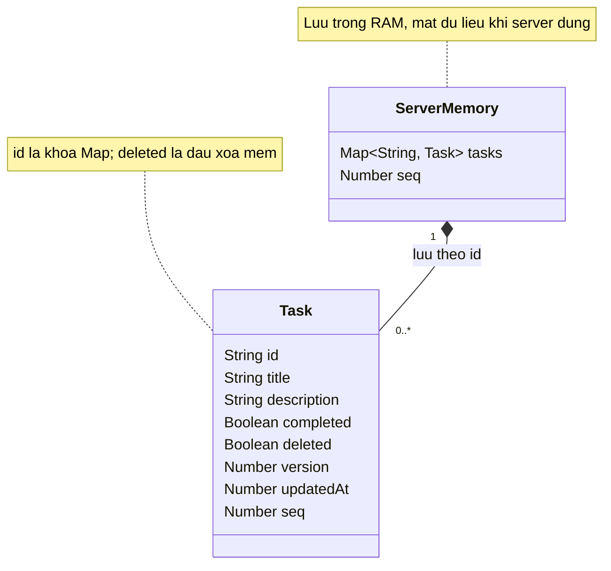

# TÀI LIỆU PHÂN TÍCH THIẾT KẾ (DELIVERABLE D2 - PHẦN NGƯỜI A)
**Đề tài**: Xây dựng Ứng dụng Quản lý Công việc Hỗ trợ Đồng bộ Tự động (Offline-First Task Manager)  
**Người phụ trách**: Người A (Android Client Lead)  

---

## 1. YÊU CẦU HỆ THỐNG (REQUIREMENTS SPECIFICATION)

### 1.1. Yêu cầu Chức năng (Functional Requirements - FR)
- **FR01 - Quản lý tác vụ đầy đủ (Full CRUD)**:
  - Cho phép người dùng Xem danh sách, Thêm mới, Chỉnh sửa tiêu đề/mô tả, Đánh dấu hoàn thành / chưa hoàn thành, và Xóa công việc.
- **FR02 - Hoạt động ngoại tuyến toàn diện (Offline-First Operation)**:
  - Tất cả các thao tác CRUD đều được thực thi và phản hồi ngay lập tức tại CSDL cục bộ mà không bị gián đoạn khi không có kết nối Internet (mất mạng, chế độ máy bay).
- **FR03 - Hiển thị trạng thái đồng bộ trực quan (Sync Status Tracking)**:
  - Mỗi công việc trên giao diện đều có huy hiệu (Badge) màu thể hiện rõ trạng thái đồng bộ:
    - `✓ Đã đồng bộ` (`SYNCED` - Xanh lá): Dữ liệu cục bộ trùng khớp hoàn toàn với máy chủ.
    - `⏳ Chờ đồng bộ` (`PENDING` - Cam): Dữ liệu vừa tạo/sửa/xóa ở chế độ Offline hoặc đang chờ đẩy lên server.
    - `⟳ Đang đồng bộ` (`SYNCING` - Xanh dương): Đang trong tiến trình truyền nhận dữ liệu với server.
    - `⚠ Lỗi đồng bộ` (`FAILED` - Đỏ): Xảy ra lỗi mạng hoặc lỗi phản hồi từ máy chủ.
- **FR04 - Tự động đồng bộ hai chiều (Automatic 2-Way Push/Pull Sync)**:
  - Sử dụng Android Jetpack WorkManager tự động phát hiện khi thiết bị có kết nối Internet để:
    - *Đẩy (Push)* các thay đổi cục bộ (`PENDING`, `FAILED`) lên máy chủ.
    - *Kéo (Pull)* các thay đổi mới nhất từ máy chủ về thiết bị dựa trên con trỏ thứ tự (`cursor / sequence`).
- **FR05 - Kích hoạt đồng bộ thủ công (Manual Sync)**:
  - Cung cấp nút bấm "Đồng bộ ngay" để người dùng chủ động yêu cầu đồng bộ tức thì mà không cần chờ lịch định kỳ.
- **FR06 - Phát hiện và Xử lý xung đột dữ liệu (Conflict Resolution)**:
  - Khi một bản ghi bị chỉnh sửa đồng thời trên hai thiết bị (phiên bản `version` bị lệch hoặc server trả HTTP 409 Conflict):
    - Hệ thống phát hiện xung đột dựa trên cơ chế khóa lạc quan (Optimistic Locking).
    - Cung cấp các chính sách tự động: Bản mới nhất thắng (Last-Write-Wins), Máy chủ thắng (Server-Wins), Bản cục bộ thắng (Client-Wins).
    - Cung cấp Hộp thoại so sánh trực quan (Conflict Resolution Dialog) để người dùng tự quyết định chọn giữ bản cục bộ hay lấy bản máy chủ.
- **FR07 - Xóa mềm (Soft Delete / Tombstone)**:
  - Khi người dùng xóa công việc, ứng dụng không xóa vĩnh viễn khỏi SQLite mà đánh dấu cờ `isDeleted = 1`, ẩn khỏi màn hình nhưng vẫn lưu vết để đồng bộ lệnh xóa lên máy chủ.

### 1.2. Yêu cầu Phi chức năng (Non-Functional Requirements - NFR)
- **NFR01 - Phản hồi tức thì & Không độ trễ (Zero-Latency UI)**:
  - Áp dụng nguyên lý *Single Source of Truth (SSOT)* với Room Database: Giao diện chỉ quan sát Room DB qua reactive `Flow`, phản hồi thao tác người dùng dưới 100ms mà không phải chờ đợi phản hồi từ mạng.
- **NFR02 - Tính toàn vẹn và Bền vững của dữ liệu (Data Integrity & Persistence)**:
  - Dữ liệu được lưu trữ an toàn trong SQLite/Room DB. Đảm bảo không mất dữ liệu ngay cả khi ứng dụng bị tắt đột ngột, crash, hoặc khởi động lại thiết bị.
  - Sử dụng mã định danh duy nhất toàn cầu UUID (`UUID.randomUUID()`) làm khóa chính, ngăn ngừa trùng lặp bản ghi khi tạo mới trên nhiều thiết bị khác nhau.
- **NFR03 - Tính lũy thừa & Chống trùng lặp (Idempotency)**:
  - Việc bấm nút đồng bộ liên tục nhiều lần hoặc các tác vụ đồng bộ chạy lặp lại không làm sinh ra các bản ghi trùng lặp trên máy chủ hay tại máy khách.
- **NFR04 - Khả năng chịu lỗi và Tự phục hồi (Fault Tolerance & Resilience)**:
  - Cơ chế thử lại tự động theo cấp số nhân (Exponential Backoff, bắt đầu từ 10 giây) khi gặp sự cố mạng chập chờn hoặc máy chủ gặp lỗi tạm thời (HTTP 500, Timeout).
- **NFR05 - Tiết kiệm năng lượng và Băng thông (Resource Efficiency)**:
  - WorkManager được cấu hình ràng buộc mạng (`NetworkType.CONNECTED`), chỉ chạy ngầm khi thực sự có mạng, tránh tiêu hao pin và tài nguyên thiết bị vô ích.
  - Đồng bộ gia tăng (Delta Sync): Chỉ tải về những bản ghi có số thứ tự thay đổi lớn hơn `cursor` đã lưu lần trước.
- **NFR06 - Tính tương thích nền tảng (Compatibility)**:
  - Ứng dụng hỗ trợ tối thiểu từ Android 8.0 (API Level 26) đến Android 14+ (API Level 34).

---

## 2. SƠ ĐỒ CA SỬ DỤNG PHÍA CLIENT (USE CASE DIAGRAM)

### Bảng đặc tả các ca sử dụng chính:
- **UC01: Xem danh sách**: Người dùng mở ứng dụng, danh sách công việc hiển thị ngay từ Room DB kèm badge trạng thái đồng bộ (`SYNCED`, `PENDING`, `SYNCING`, `FAILED`).
- **UC02: Thêm mới công việc**: Nhập tiêu đề, mô tả. Dữ liệu được gán UUID, lưu vào Room với `syncStatus = PENDING`, kích hoạt WorkManager.
- **UC03: Sửa công việc**: Cho phép cập nhật tiêu đề, mô tả. Trạng thái chuyển thành `PENDING`, cập nhật timestamp `updatedAt`.
- **UC04: Hoàn thành / Chưa xong**: Tích chọn checkbox, cập nhật trạng thái `isCompleted` trong Room.
- **UC05: Xóa công việc**: Đánh dấu `isDeleted = 1`, ẩn khỏi UI, giữ lại để gửi Tombstone lên server.
- **UC06: Đồng bộ thủ công**: Bấm nút "Đồng bộ ngay" để gọi `enqueueUniqueWork` chạy ngay lập tức.
- **UC07: Giải quyết xung đột**: Khi phát hiện dữ liệu trên server có phiên bản mới hơn phiên bản cơ sở (Base Version), hiển thị dialog so sánh hai phiên bản để người dùng chọn.

---

## 3. SƠ ĐỒ THÀNH PHẦN CLIENT (COMPONENT DIAGRAM)

---

## 4. SƠ ĐỒ TUẦN TỰ: LUỒNG THÊM CÔNG VIỆC VÀ TỰ ĐỘNG ĐỒNG BỘ (SEQUENCE DIAGRAM)

## 5. SƠ ĐỒ LUỒNG TỔNG THỂ:

- Push trước, pull sau; một lượt push có thể gồm nhiều task, không phải chỉ một HTTP request.
- Khi PUT thành công, engine chỉ đánh dấu SYNCED nếu local còn khớp snapshot gửi đi; nếu đã sửa tiếp thì giữ PENDING và cập nhật version cơ sở.
- Khi pull: chèn ID chưa có; thay bản local SYNCED nếu version server không nhỏ hơn; giữ lại bản local đang chờ đồng bộ.
- Lỗi pull không tiến cursor, nhưng các task đã được PUT xác nhận vẫn có thể SYNCED.
- Mutex chỉ tuần tự hóa các phiên trong cùng tiến trình app. Cancellation được chuyển lại cho WorkManager, không đi qua nhánh retry lỗi thông thường trong sơ đồ

---

## 6. THIẾT KẾ CƠ SỞ DỮ LIỆU CỤC BỘ ROOM (ERD)

### Bảng: `tasks`

---

## 7. THIẾT KẾ CƠ SỞ DỮ LIỆU SERVER (ERD)

### Mô tả chi tiết các ràng buộc và chỉ mục:
1. **Khóa chính (`id`)**: Dùng kiểu chuỗi `UUID.randomUUID().toString()`, đảm bảo tính duy nhất trên nhiều thiết bị mà không cần chờ Server cấp phát ID tự tăng.
2. **Cờ `isDeleted`**: 
   - Mặc định là `false` (`0`).
   - Khi xóa: Chuyển sang `true` (`1`).
   - Truy vấn hiển thị: `WHERE isDeleted = 0`.
3. **Cột `syncStatus`**:
   - `PENDING`: Cần đẩy lên server khi có mạng.
   - `SYNCING`: Đang trong tiến trình đẩy dữ liệu.
   - `SYNCED`: Đã đồng bộ thành công và trùng khớp với server.
   - `FAILED`: Lỗi mạng hoặc từ chối từ server.
4. **Cột `version`**:
   - Khởi tạo ban đầu là `1L`. Mỗi lần người dùng cập nhật hoặc giải quyết xung đột, giá trị này được tăng lên để hỗ trợ kỹ thuật Optimistic Concurrency Control.
