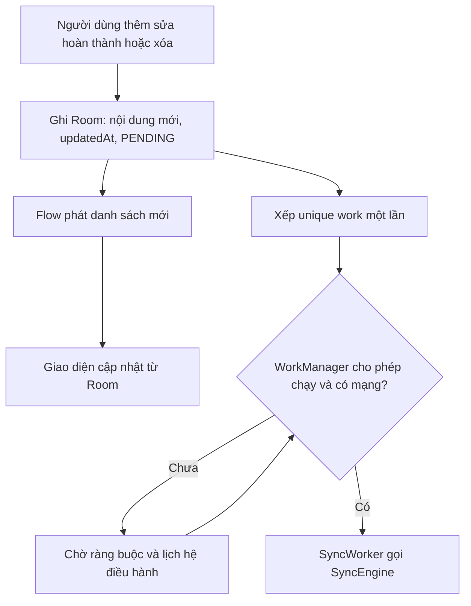
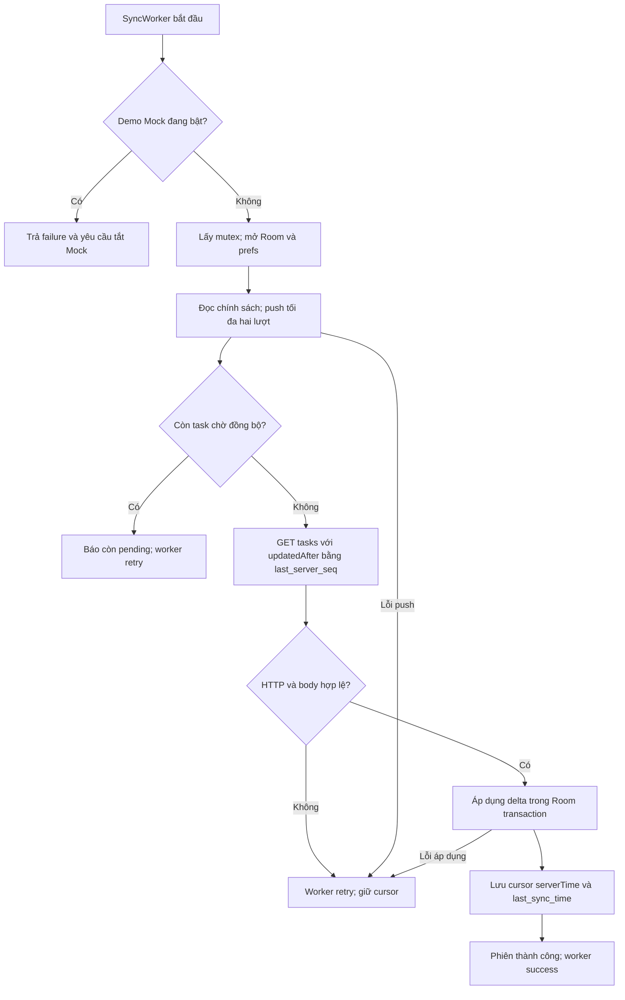
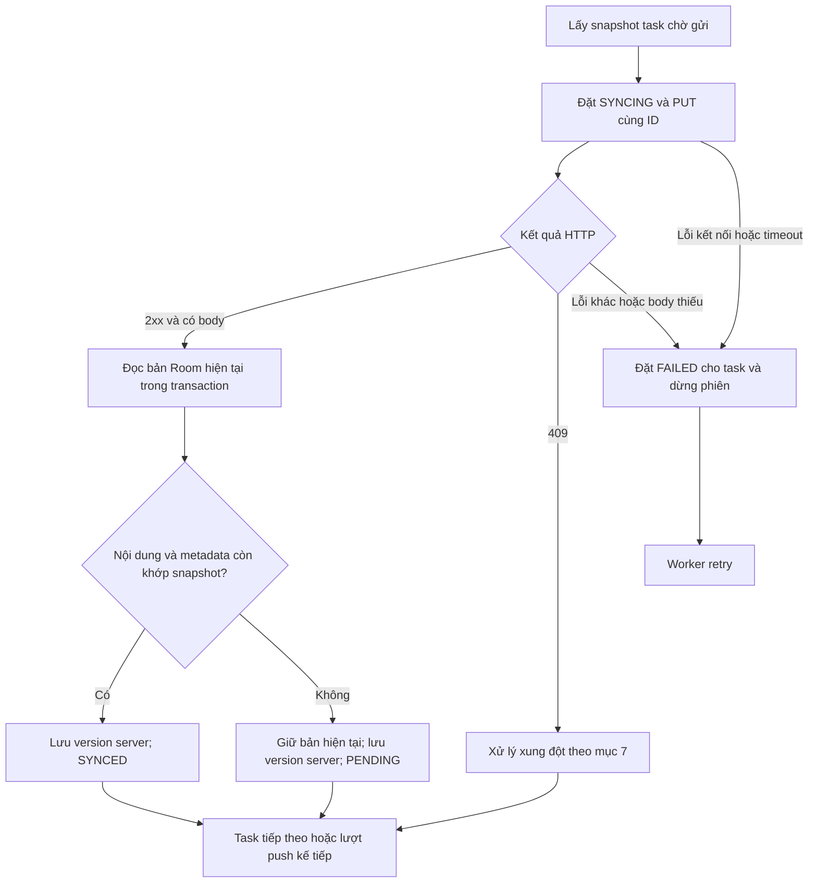
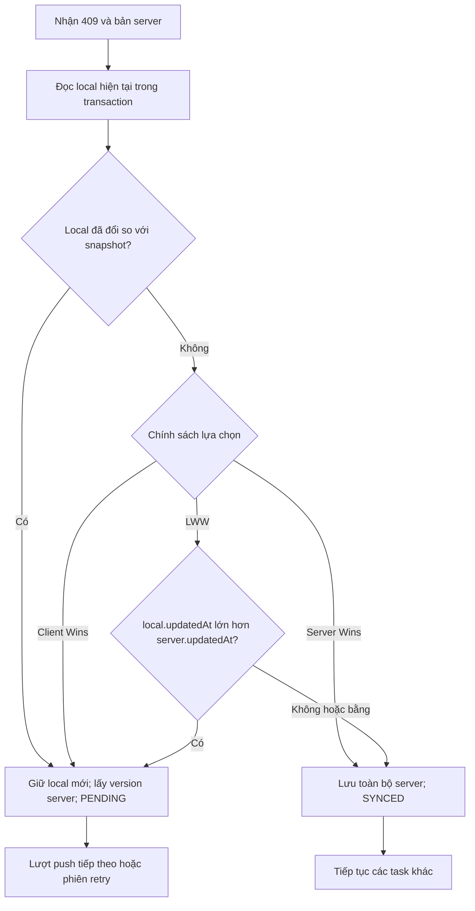

# D5. Mô-đun đồng bộ và xử lý xung đột

- **Dự án:** Android Auto Sync – TaskManagerApp.
- **Người biên soạn:** PeterKhang3012.

## 1. Mục tiêu và đối chiếu yêu cầu

Ứng dụng sử dụng Room làm nguồn dữ liệu cho giao diện. Người dùng thao tác cục bộ trước; WorkManager thực hiện trao đổi dữ liệu với server khi có mạng. 

| Yêu cầu D5 | Cơ chế hiện có | Mã nguồn minh chứng |
| --- | --- | --- |
| Đồng bộ hai chiều | PUT thay đổi local; GET delta từ server, áp dụng vào Room | `SyncEngine.sync()` |
| Theo dõi thay đổi cục bộ | `syncStatus`, `updatedAt`; lấy PENDING/FAILED/SYNCING | `TaskRepository`, `TaskEntity`, `TaskDao.getPendingTasks()` |
| Xóa logic | Giữ bản ghi với `isDeleted = true`; truyền `deleted` qua API | `TaskDao.softDeleteTask()`, mapper DTO, server |
| Retry | `Result.retry()` và exponential backoff khi có mạng | `SyncWorker`, `TaskRepository.triggerSyncWork()` |
| Tránh gửi trùng | ID ổn định, upsert theo ID, kiểm tra version; khóa phiên sync trong tiến trình | `TaskEntity`, `Server.js`, `SyncEngine` |
| Xử lý xung đột | HTTP 409; LWW, Server Wins, Client Wins; bảo vệ bản sửa trong lúc gửi | `ConflictResolver`, nhánh xử lý 409 trong `SyncEngine` |
| Minh chứng thuật toán | Sơ đồ tổng quan, push và xử lý xung đột | Mục 4–7 |
| Ví dụ tình huống | Offline, hai thiết bị sửa, xóa, timeout/gửi lại | Mục 8–9 |

Chi tiết endpoint, body, response và triển khai server được mô tả riêng trong [D4. Mã nguồn máy chủ và API](D4_Ma_Nguon_May_Chu_Va_API.md).

## 2. Danh mục mã nguồn tham chiếu

Các đường dẫn sau tính từ thư mục tài liệu hiện tại:

| File | Trách nhiệm |
| --- | --- |
| [TaskEntity.kt](../app/src/main/java/com/example/taskmanagerapp/data/local/TaskEntity.kt) | UUID, nội dung task, trạng thái local, version và dấu xóa |
| [TaskDao.kt](../app/src/main/java/com/example/taskmanagerapp/data/local/TaskDao.kt) | Truy vấn Flow, ghi Room, lấy bản chờ đồng bộ |
| [TaskDatabase.kt](../app/src/main/java/com/example/taskmanagerapp/data/local/TaskDatabase.kt) | Room database dùng chung trong app |
| [TaskRepository.kt](../app/src/main/java/com/example/taskmanagerapp/repository/TaskRepository.kt) | Thao tác local, xếp việc một lần, xử lý lựa chọn trong dialog |
| [TaskViewModel.kt](../app/src/main/java/com/example/taskmanagerapp/ui/TaskViewModel.kt) | Kết nối giao diện và repository, cung cấp StateFlow và WorkInfo |
| [SyncEngine.kt](../app/src/main/java/com/example/taskmanagerapp/sync/SyncEngine.kt) | Khóa đồng bộ, push/pull, giải quyết 409 và thống kê |
| [SyncWorker.kt](../app/src/main/java/com/example/taskmanagerapp/sync/SyncWorker.kt) | Chạy engine trong WorkManager; retry và đăng ký việc định kỳ |
| [TaskApiService.kt](../app/src/main/java/com/example/taskmanagerapp/data/remote/TaskApiService.kt) | Retrofit GET/PUT và API mô phỏng |
| [TaskDto.kt](../app/src/main/java/com/example/taskmanagerapp/data/remote/TaskDto.kt) | Ánh xạ `isCompleted`/`isDeleted` sang `completed`/`deleted` |
| [RetrofitClient.kt](../app/src/main/java/com/example/taskmanagerapp/data/remote/RetrofitClient.kt) | Địa chỉ server và timeout kết nối/đọc/ghi 5 giây |
| [MainActivity.kt](../app/src/main/java/com/example/taskmanagerapp/MainActivity.kt) | Nút đồng bộ, chọn chính sách, đăng ký periodic work, dialog mô phỏng |
| [TaskAdapter.kt](../app/src/main/java/com/example/taskmanagerapp/ui/TaskAdapter.kt) | Badge trạng thái và hiển thị danh sách từ Room |
| [Server.js](../server/Server.js) | Lưu theo ID, kiểm tra version, cấp seq, trả delta và tombstone |
| [ConflictResolverTest.kt](../app/src/test/java/com/example/taskmanagerapp/sync/ConflictResolverTest.kt) | Test chính sách, trường hợp timestamp bằng nhau |
| [TaskDaoTest.kt](../app/src/androidTest/java/com/example/taskmanagerapp/TaskDaoTest.kt) | Test thao tác Room, xóa mềm và trạng thái |
| [sync.test.js](../server/test/sync.test.js) | Test HTTP về version, delta, retry và tombstone |

## 3. Trạng thái và thông tin đồng bộ

### 3.1. Các trường quan trọng

| Thông tin | Vị trí | Ý nghĩa |
| --- | --- | --- |
| `id` | Room và server | UUID do client tạo một lần; giữ nguyên khi chỉnh sửa hoặc gửi lại |
| `syncStatus` | Room | PENDING, SYNCING, SYNCED, FAILED; không gửi làm trạng thái server |
| `updatedAt` | Room và DTO | Thời điểm chỉnh sửa nội dung theo đồng hồ thiết bị; dùng cho LWW |
| `version` | Room và server | Phiên bản server làm cơ sở cho bản sửa local; không tự tăng khi chỉ sửa offline |
| `isDeleted` / `deleted` | Room / JSON | Dấu xóa mềm; bản ghi vẫn tồn tại để truyền thao tác xóa |
| `seq` | Server và DTO trả về | Số thứ tự thay đổi toàn server trong một tiến trình |
| `last_server_seq` | SharedPreferences `task_sync_prefs` | Cursor của lần pull đã áp dụng thành công |
| `last_sync_time` | SharedPreferences | Thời điểm phía client hoàn tất push/pull; khác cursor |
| `conflict_policy` | SharedPreferences | Chính sách lựa chọn khi nhận 409; mặc định LWW |

### 3.2. Chuyển trạng thái

| Sự kiện | Trạng thái sau xử lý |
| --- | --- |
| Tạo/sửa/hoàn thành/xóa mềm local | PENDING |
| Engine chuẩn bị gửi snapshot | SYNCING |
| PUT thành công, local chưa sửa tiếp | SYNCED, lưu version server trả về |
| PUT thành công nhưng local đã sửa tiếp | PENDING, lưu version mới và giữ nội dung hiện tại |
| Lỗi gửi hoặc xử lý một task, không phải cancellation | FAILED cho task đang xử lý; worker yêu cầu retry |
| 409, chọn server và local chưa đổi trong khi chờ | Thay bằng DTO server, SYNCED |
| 409, chọn client hoặc phát hiện local đã đổi trong khi chờ | Giữ local, đặt version cơ sở theo server, PENDING |
| Pull nhận task mới hoặc bản hợp lệ thay thế local đã SYNCED | Ghi Room với SYNCED |

DAO lấy cả SYNCING để có thể xử lý lại bản ghi nếu phiên trước bị ngắt. Không phải mọi lỗi phiên sync đều đánh dấu toàn bộ task FAILED: lỗi ở bước pull chỉ làm worker retry, các task đã được push xác nhận vẫn có thể SYNCED.

## 4. Theo dõi thay đổi cục bộ và kích hoạt đồng bộ

Các thao tác repository đều ghi Room trước, sau đó xếp WorkManager. Vì vậy thao tác local không cần đợi HTTP mới cập nhật giao diện.

- `insertTask()`: tạo task PENDING và cập nhật `updatedAt`.
- `updateTask()`: đọc bản hiện tại trong transaction, thay trạng thái hoàn thành, đặt PENDING và thời gian mới.
- `editTask()`: đọc bản hiện tại trong transaction, sửa title/description, đặt PENDING và thời gian mới.
- `deleteTask()`: đặt `isDeleted = true`, PENDING và thời gian mới; không xóa cứng.
- `getAllTasks()`: Flow chỉ lấy `isDeleted = 0`; ViewModel chuyển thành StateFlow, Activity cập nhật adapter.



### 4.1. WorkManager và chống chạy đồng thời

| Cơ chế | Cấu hình hiện tại | Phạm vi bảo đảm |
| --- | --- | --- |
| Việc một lần | `TaskSyncUniqueWork`, `APPEND_OR_REPLACE` | Các yêu cầu được nối chuỗi; không thay thế/hủy việc đang gửi |
| Ràng buộc | `NetworkType.CONNECTED` | Chờ có kết nối mạng; không bảo đảm server thực sự truy cập được |
| Retry | Exponential backoff, mức khởi đầu 10 giây | Thời gian chạy thực tế còn do WorkManager/hệ điều hành quyết định |
| Việc định kỳ | `PeriodicTaskSync`, chu kỳ 15 phút, policy KEEP | Đăng ký trong `MainActivity.onCreate()`; không bảo đảm chạy đúng từng mốc 15 phút |
| Khóa phiên | `Mutex.withLock` trong singleton SyncEngine | Serialize manual/periodic sync trong cùng tiến trình app; không khóa các thiết bị khác |

Nhấn nút đồng bộ thủ công cũng chỉ xếp việc có ràng buộc mạng, không bỏ qua WorkManager để gửi HTTP ngay lập tức. APPEND_OR_REPLACE không có nghĩa chỉ tồn tại một request trong hàng đợi; nhiều thao tác có thể tạo nhiều việc nối tiếp.

WorkManager lưu việc để hệ thống quản lý qua thay đổi vòng đời và reboot trong phạm vi Android cho phép.

## 5. Thuật toán một phiên đồng bộ



Engine ghi số lần, số thành công, tổng thời gian, số xung đột và số pushed/pulled gần nhất trong `finally`. Mutex được nhả khi thoát khối `withLock`, kể cả khi có lỗi. Thống kê là tổng hợp trong SharedPreferences, không phải nhật ký đầy đủ từng request.

### 5.1. Push tối đa hai lượt

Mỗi lượt truy vấn lại các task PENDING, FAILED hoặc SYNCING. Lượt thứ hai cho phép gửi tiếp bản client thắng sau 409, hoặc bản local vừa được sửa thêm trong lúc request trước đang chạy.



Khi so khớp, engine bỏ qua khác biệt do chính trường `syncStatus` đã đổi sang SYNCING, còn lại dùng phép so sánh data class. Cách này có thể phát hiện sửa đổi nội dung ngay cả khi hai thao tác có cùng timestamp mili giây. Network call chạy ngoài transaction; đọc và ghi kết quả vào Room nằm trong transaction.

Nếu sau hai lượt vẫn còn task chờ gửi, engine yêu cầu retry; không lặp vô hạn trong một phiên. Một lỗi ở task hiện tại dừng phiên, nên các task sau trong lượt có thể chưa được gửi.

### 5.2. Pull dữ liệu thay đổi

Client gọi `GET /tasks?updatedAfter=<last_server_seq>`. Với mỗi DTO:

| Tình trạng local | Cách áp dụng |
| --- | --- |
| Chưa có ID | Chèn DTO dưới trạng thái SYNCED, kể cả tombstone |
| Đã SYNCED và `dto.version >= local.version` | Thay bằng bản server |
| Đã SYNCED nhưng version server nhỏ hơn | Không thay thế |
| Đang PENDING/FAILED/SYNCING | Không ghi đè bản chưa đồng bộ |

Sau transaction áp dụng delta thành công, engine lưu `delta.serverTime` vào `last_server_seq`. Nếu HTTP hoặc transaction lỗi, không tiến cursor. Room và SharedPreferences không nằm trong một transaction chung; nếu tiến trình ngắt giữa ghi Room và lưu cursor, lần sau có thể nhận lại delta. Upsert cùng ID giúp không tạo thêm dòng trùng khóa.

Bản local sửa trong lúc pull có thể được giữ lại và xử lý ở lần push tiếp theo. Bộ đếm `pulled` hiện tăng cho mỗi DTO duyệt qua, không chỉ các DTO thực sự ghi vào Room; không dùng nó làm số lượng cập nhật thành công tuyệt đối.

## 6. Xóa logic, retry và tránh gửi trùng

### 6.1. Xóa logic

1. Xóa trên A chỉ đặt `isDeleted = true`, PENDING; Flow lọc task khỏi giao diện ngay.
2. A gửi PUT cùng ID với JSON `deleted: true` và version cơ sở.
3. Server lưu tombstone, tăng version và seq.
4. B pull delta và lưu `isDeleted = true`; task biến mất khỏi danh sách B.

Tombstone không bị loại khỏi API delta. Xóa local chưa đồng bộ vẫn cần giữ lại để gửi server. Nếu xóa và sửa xảy ra độc lập trên hai thiết bị, áp dụng chính sách xung đột cho toàn bộ bản ghi; không có quy tắc riêng “xóa luôn thắng”. Một bản sửa còn `deleted: false` thắng có thể làm task xuất hiện lại.

### 6.2. Retry

- Lỗi mạng, HTTP không thành công hoặc xử lý engine thất bại dẫn đến `Result.retry()`.
- WorkManager xếp lịch lại theo backoff và ràng buộc mạng; không bảo đảm retry đúng 10 giây.
- CancellationException được ném lại cho WorkManager, không chuyển thành lỗi nghiệp vụ và không bảo đảm task đang gửi được đặt FAILED. DAO vẫn lấy SYNCING để phục hồi.
- HTTP 409 được xử lý riêng trong engine; không tự coi mọi 409 là lỗi kết nối.
- Hiện worker retry cả exception do lỗi không tạm thời, ví dụ request 400; chưa phân loại đầy đủ để dừng hoặc yêu cầu người dùng sửa dữ liệu. Đây là hạn chế, không phải cơ chế đã hoàn thiện.

### 6.3. Phạm vi tránh gửi trùng

| Cơ chế | Tác dụng | Giới hạn |
| --- | --- | --- |
| UUID giữ nguyên | Các lần gửi lại trỏ cùng task | Hai UUID khác nhau với cùng title vẫn là hai task |
| Map trên server theo ID; khóa chính Room | Không chèn thêm dòng cùng ID | Không nhận diện nội dung trùng nghĩa |
| Kiểm tra version | Request dựa trên version cũ nhận 409, không ghi đè ngay | Cần client xử lý 409; không bảo đảm mọi retry đều trả 200 |
| Mutex và unique work | Giảm request chồng nhau trong cùng app | Không loại bỏ mọi lần gửi lại, không serialize hai thiết bị |

Đây không phải bảo đảm **exactly-once**. Server chưa có idempotency key hoặc kho lưu kết quả theo request ID. Ví dụ PUT đã áp dụng nhưng mất response: gửi lại version cũ nhận 409, client so sánh/giải quyết rồi mới tiếp tục; server không tự trả lại response thành công cũ.

## 7. Phát hiện và xử lý xung đột

### 7.1. Điều kiện phát hiện

Giả sử A và B đều tải task version 1. A sửa offline vẫn giữ version cơ sở 1. B gửi bản sửa trước và server cấp version 2. Khi A gửi version 1, server thấy khác version 2 nên trả `409` cùng bản server.

Server kiểm tra **khác version**, không dùng timestamp để quyết định có xung đột hay không. Gửi lại request đã áp dụng nhưng mất response cũng có thể gây 409; vì vậy số 409 không đồng nghĩa số lần hai người thực sự sửa độc lập.

### 7.2. Chính sách đã triển khai

**Local** là bản công việc trong Room của thiết bị đang đồng bộ. **Server** là bản hiện tại do API trả trong 409. “Thắng” nghĩa là chọn nội dung toàn bộ bản ghi, không gộp riêng từng trường.

| Chính sách | Điều kiện và cách xử lý |
| --- | --- |
| LAST_WRITE_WINS, mặc định | Local mới hơn: giữ nội dung local, đặt version cơ sở bằng version server, PENDING để gửi tiếp. Local cũ hơn: lấy toàn bộ bản server. Hai timestamp bằng nhau: lấy toàn bộ bản server. |
| SERVER_WINS | Khi bản local chưa thay đổi thêm trong lúc request chạy, thay bằng toàn bộ bản server và đánh dấu SYNCED. |
| CLIENT_WINS | Giữ nội dung local, đặt version cơ sở bằng version server rồi gửi tiếp; không tự cộng version trước khi PUT. |

Quy tắc LWW trong mã nguồn:

```kotlin
local.updatedAt > server.updatedAt
```

`updatedAt` là thời điểm chỉnh sửa bản ghi, không phải thời điểm bắt đầu hoặc kết thúc đồng bộ. Các timestamp phải cùng đơn vị và đồng hồ thiết bị đủ chính xác thì so sánh mới có ý nghĩa về thứ tự thời gian thực.

### 7.3. Ngoại lệ bảo vệ bản sửa khi request đang chạy

Trước khi áp dụng kết quả 409, engine đọc lại local. Nếu bản hiện tại đã khác snapshot gửi đi, engine **giữ bản hiện tại**, cập nhật version cơ sở theo server và đặt PENDING, kể cả khi đang chọn Server Wins. Khi bản giữ lại được gửi thành công ở lượt sau, có thể không phát sinh thêm 409 để áp dụng lại chính sách.

Vì vậy không mô tả Server Wins là “server luôn thắng trong mọi tình huống”. Đây là nhánh bảo vệ chỉnh sửa mới đang có trong code; nếu muốn chính sách tuyệt đối khác đi, cần thống nhất yêu cầu rồi mới sửa thuật toán.



### 7.4. Lý do chọn mặc định và nguy cơ mất dữ liệu

LWW là lựa chọn mặc định dễ giải thích trong demo: khi không gộp trường, ưu tiên bản được chỉnh sửa muộn hơn, và chọn server để có kết quả xác định khi bằng timestamp. Đây không phải cam kết luôn giữ bản đúng nhất theo ý người dùng.

- Đồng hồ A nhanh hơn B có thể khiến một bản sửa thực tế cũ hơn vẫn thắng.
- A sửa title và B sửa description: chỉ một bản thắng, nên thay đổi của bên kia có thể mất.
- Server Wins có thể bỏ bản sửa offline mới của người dùng; Client Wins có thể thay thế bản mới của thiết bị khác.
- Chỉnh sửa và xóa đồng thời có thể làm mất bản sửa hoặc khôi phục task đã xóa, tùy bản được chọn.
- Không có lịch sử phiên bản hoặc gộp theo từng trường để khôi phục tự động dữ liệu bên thua.

Người dùng chọn chính sách trong menu **Chính sách xung đột**; engine đọc chính sách một lần đầu phiên sync. Đổi menu trong lúc phiên chạy không thay đổi chính sách phiên đó.

### 7.5. Dialog thủ công và xung đột tự động

Trong luồng sync thật, engine tự xử lý 409 theo chính sách. Nó không tự mở dialog cho mọi xung đột.

Nhấn giữ task → **Mô phỏng xung đột dữ liệu** là luồng demo riêng: Activity gọi `/admin/simulate-edit/:id`, nhận bản server rồi mở dialog. Giữ local sẽ đặt version theo bản server và PENDING; giữ server sẽ lưu toàn bộ DTO. Repository kiểm tra local còn khớp bản lúc mở dialog trước khi ghi; nếu đã đổi thì không ghi đè bằng lựa chọn dựa trên snapshot cũ.

Luồng demo này chứng minh giao tiếp và lựa chọn local/server, không thay thế thử nghiệm hai thiết bị thực sự sửa độc lập.

## 8. Ví dụ minh họa thuật toán

Các bảng dưới giả định request thành công khi không nêu lỗi, không có sửa đổi chen ngang, đồng hồ thiết bị đúng và chỉ một task được xét. Version và seq là khái niệm riêng; ví dụ không giả định version bằng cursor.

### 8.1. Tạo task offline và khôi phục mạng

| Bước | Thiết bị A | Server / thiết bị B |
| --- | --- | --- |
| 1 | Offline; tạo task ID K, version 0, PENDING; UI hiện ngay | Chưa có K |
| 2 | Có mạng; worker gửi PUT K, version 0 | Server tạo K, trả version 1 |
| 3 | Lưu version 1, SYNCED nếu local chưa đổi | B pull và nhận K cùng ID |

Đây là một task có chung ID trên các nơi lưu, không phải ba task độc lập.

### 8.2. A và B sửa cùng task

Ban đầu: cả A và B có K, version 1, title “Báo cáo”.

| Bước | A | B / server |
| --- | --- | --- |
| 1 | Offline sửa “Bản A” lúc 10:05, giữ version 1 | B chưa sửa |
| 2 | Vẫn offline | B sửa “Bản B” lúc 10:06; gửi version 1; server lưu version 2 |
| 3 | Có mạng; gửi “Bản A”, version 1 | Server trả 409 và “Bản B”, version 2 |

Kết quả theo chính sách chọn trên A:

| Chính sách | Kết quả trên A và server | Sau khi B đồng bộ lại |
| --- | --- | --- |
| LWW | Bản B mới hơn; A nhận bản B version 2 | B vẫn là bản B |
| Server Wins | A nhận bản B version 2 | B vẫn là bản B |
| Client Wins | A giữ bản A, dùng version cơ sở 2 rồi gửi; server cấp version 3 | B nhận bản A version 3 |

Nếu A sửa lúc 10:07 thay vì 10:05 thì LWW chọn bản A. Nếu A cũng sửa lúc 10:06 với timestamp bằng nhau thì LWW chọn bản B trên server.

### 8.3. Server đã nhận nhưng client timeout

1. A gửi PUT K dựa trên version 1.
2. Server ghi thành công và cấp version 2, nhưng response không tới A.
3. A vẫn giữ version cơ sở 1 và worker retry.
4. PUT gửi lại cùng K, version 1 nhận 409 cùng bản version 2; không tạo ID mới.
5. Với LWW và timestamp bằng nhau, A nhận server và SYNCED. Với Client Wins, có thể gửi lại cùng nội dung dựa trên version 2 và server cấp version 3: không thêm task, nhưng vẫn tăng version/seq.

Tình huống này cho thấy khác biệt giữa tránh task trùng và bảo đảm thao tác chỉ được xử lý đúng một lần.

### 8.4. Xóa offline và truyền sang B

A và B cùng có K version 1. A offline xóa mềm K, UI A ẩn K nhưng Room còn tombstone. Khi có mạng, A PUT `deleted: true`, version 1; server trả version 2. B pull nhận tombstone rồi ẩn K. Nếu B đã sửa độc lập trước đó, phải qua xử lý 409, không bảo đảm xóa luôn thắng.

### 8.5. Người dùng tiếp tục sửa khi PUT đang chạy

A gửi snapshot “Bản 1”. Trong lúc chờ, người dùng sửa local thành “Bản 2”, PENDING. Khi server trả thành công cho “Bản 1”, engine đọc lại Room và thấy khác snapshot. Nó giữ “Bản 2”, cập nhật version cơ sở và để PENDING; lượt push tiếp theo gửi “Bản 2”. Không đánh dấu “Bản 2” là đã được server xác nhận dựa trên response của “Bản 1”.

### 8.6. Lỗi pull sau khi push thành công

A push K thành công, K được đánh dấu SYNCED. GET delta sau đó lỗi 500. Engine không tiến cursor và worker retry; phiên chưa được coi thành công. K vẫn có thể SYNCED vì PUT đã xác nhận, còn dữ liệu mới từ thiết bị khác chưa chắc đã về A. Badge của một task không đồng nghĩa toàn bộ phiên push/pull đã hoàn tất.