# D6. Bộ kiểm thử và kết quả kiểm thử

- **Dự án:** Android Auto Sync – TaskManagerApp.
- **Người biên soạn:** PeterKhang3012.
- **Mã nguồn đối chiếu trong cloud:** `feature/my-sync`, commit `c6ef837`. Commit thực tế chạy trên máy người dùng chưa được cung cấp; không mặc định hai môi trường cùng phiên bản.
- **Ngày thực hiện:** 30/10/2026.
- **Trạng thái:** bản nháp đã cập nhật kết quả người dùng cung cấp; chưa commit/push.
- **Phạm vi:** kết quả HTTP thực thi trong cloud; báo cáo HTML test Android và xác nhận kiểm thử thủ công trên máy người dùng. Không sửa mã nguồn, cấu hình hoặc test có sẵn.

## 1. Quy ước kết quả

| Trạng thái | Ý nghĩa |
| --- | --- |
| PASS | Đã thực thi, các điều kiện xác nhận của ca kiểm thử đều đúng |
| FAIL | Đã thực thi và có điều kiện xác nhận không đúng |
| BLOCKED | Bị chặn bởi môi trường trước khi hoàn tất kiểm thử |
| NOT RUN | Chưa có xác nhận đã thực thi; không suy ra PASS từ việc đã có code |
| CHƯA KẾT LUẬN | Đã có quan sát/thử nghiệm nhưng chưa đủ thông tin xác định kết quả theo tiêu chí |

Không gộp số ca HTTP kiểm tra bổ sung với số test do `node --test` đăng ký. Không lấy tỷ lệ pass của server để đại diện cho toàn bộ hệ thống Android.

## 2. Môi trường và phạm vi kiểm thử

### 2.1. Kiểm thử server trong cloud

- Linux x86_64, kernel 6.18.55; Node.js v24.19.0, npm 11.9.0.
- Express được cài theo [package-lock.json](../server/package-lock.json).
- Server được import từ [Server.js](../server/Server.js), mở cổng tạm trên `127.0.0.1`.
- HTTP thật qua loopback; kho Map RAM mới của tiến trình thử, không dùng server của teammate.
- Có các request độc lập đóng vai client, không có Android emulator hoặc Room thực sự trong phép thử HTTP này.
- Bộ test server và harness tạm chạy riêng; dữ liệu RAM của mỗi tiến trình không ảnh hưởng nhau.
- Harness/log nằm tạm trong `/tmp`; nội dung nguồn và log được nhúng vào D6/D7 để minh chứng không phụ thuộc việc giữ thư mục tạm.

### 2.2. Kiểm thử Android trên máy người dùng

- Máy Windows, project mở bằng Android Studio; chưa có phiên bản Android Studio, JDK và cấu hình phần cứng cụ thể.
- Báo cáo HTML được tạo bởi **Gradle 9.6.0** ngày 30/10/2026.
- Ảnh người dùng cung cấp hiển thị hai emulator: **Medium Phone API 37.0** và **Small Phone API 37.0**, app mở trên cả hai.
- Người dùng ban đầu gặp giới hạn chỉ mở được một emulator tại một thời điểm; ảnh sau đó đã có cả hai. Không dùng trở ngại ban đầu để kết luận các ca hai thiết bị vẫn bị chặn hoàn toàn.
- Báo cáo instrumented test tổng hợp chưa có trang chi tiết theo thiết bị, nên chưa xác nhận mỗi test đã chạy trên emulator nào.
- Nguồn minh chứng Android là nội dung HTML và ảnh được gửi trong cuộc trao đổi, không phải test do agent thực thi trên máy người dùng. Chưa đính kèm file HTML/ảnh gốc vào repository.

## 3. Bộ kiểm thử đã có trong repository

| Bộ kiểm thử | Nội dung | Kết quả đợt này |
| --- | --- | --- |
| [server/test/sync.test.js](../server/test/sync.test.js) | Tạo, delta, xung đột, gửi lại, tombstone, validation, chaos, reset | PASS: 1 test tích hợp, 0 fail |
| [ConflictResolverTest.kt](../app/src/test/java/com/example/taskmanagerapp/sync/ConflictResolverTest.kt) | 2 test: LWW mới/cũ/bằng timestamp và chính sách client/server | PASS trên máy người dùng: 2 test, 0 fail, 0 skipped; cloud vẫn BLOCKED |
| [TaskDaoTest.kt](../app/src/androidTest/java/com/example/taskmanagerapp/TaskDaoTest.kt) | 4 test được định nghĩa trong source đối chiếu: insert/read, soft delete, lọc pending/failed, cập nhật trạng thái | PASS theo HTML người dùng: 8 lượt, 0 fail, 0 skipped; chưa xác nhận phân bố theo thiết bị |

Tên test DAO `getPendingTasks_shouldReturnPendingAndFailedOnly` phản ánh tên cũ; dữ liệu test hiện không có bản SYNCING, trong khi DAO thực tế lấy cả SYNCING. Không coi bộ test này là minh chứng đã kiểm tra phục hồi task SYNCING.

### 3.1. Lệnh và log test server

Từ `TaskManagerApp/server`:

```sh
npm test
```

Log của lần chạy này:

```text
> server@1.0.0 test
> node --test

✔ push, delta, conflict, retry, tombstone and recovery use the Android contract (105.827996ms)
ℹ tests 1
ℹ suites 0
ℹ pass 1
ℹ fail 0
ℹ cancelled 0
ℹ skipped 0
ℹ todo 0
ℹ duration_ms 218.696557
```

Một test trên chứa nhiều assertion nhưng runner vẫn báo **1 test**, không phải nhiều test độc lập. Thời lượng runner là thời gian chạy bộ test, không phải thời gian đồng bộ Android.

## 4. Ca kiểm thử HTTP bổ sung đã thực hiện

Harness dùng Node.js `fetch`, `assert/strict` và cùng Express app đang có. Nguồn harness nằm trong phụ lục của [D7](D7_Bao_Cao_Thuc_Nghiem_Va_Danh_Gia.md). Các ca chạy nối tiếp trong một tiến trình.

| ID | Tình huống và bước chính | Điều kiện xác nhận | Thực tế | Kết quả |
| --- | --- | --- | --- | --- |
| API-01 | PUT tạo ID `check`, version 0 | HTTP 200, version trả về 1 | Đúng cả hai điều kiện | PASS |
| API-02 | Gửi lại cùng ID với version 0 | HTTP 409; GET toàn bộ chỉ có một task | 409; danh sách có 1 task | PASS |
| API-03 | Simulate-edit ID trên, rồi PUT version 1 | HTTP 409, response server version 2 | 409; version 2 | PASS |
| API-04 | PUT cùng ID, version 2, deleted=true; GET từ cursor 2 | 200; delta có đúng một tombstone | Đúng các điều kiện | PASS |
| API-05 | Bật failRate=1, GET; tắt chaos, GET lại | Lần đầu 500; sau đó 200 | 500 rồi 200 | PASS |
| API-06 | Delay 200 ms; PUT ID `timeout`, client timeout 30 ms; chờ 250 ms; tắt chaos và gửi lại version 0 | Client TimeoutError; retry 409; đúng một bản ghi ID đó | Đúng các điều kiện | PASS |
| API-07 | GET lấy cursor hiện tại rồi GET delta bằng cursor đó | tasks rỗng | tasks=[] | PASS |

API-06 kiểm tra một tình huống server nhận request trước lúc client ngừng chờ, không đại diện cho mọi dạng mất gói. Timeout thử là **30 ms**, không phải timeout 5 giây của Android. Việc gửi lại do harness chủ động thực hiện, chưa phải chứng minh WorkManager tự retry.

Log ca bổ sung:

```text
API-01: PASS
API-02: PASS
API-03: PASS
API-04: PASS
API-05: PASS
API-06: PASS
API-07: PASS
```

Kết quả: **7/7 ca bổ sung PASS**. Đây là assertion của harness, không phải 7 test mới đã được thêm vào mã nguồn repository.

## 5. Kiểm tra dữ liệu trong các lượt đo

[D7](D7_Bao_Cao_Thuc_Nghiem_Va_Danh_Gia.md) có 15 lượt đo: 10/50/100 task, mỗi mức 5 lượt. Trong mỗi lượt, harness kiểm tra:

1. Tất cả N PUT trả 200 và ghi lại response kỳ vọng.
2. GET sau push trả 200 và đúng N task.
3. Số ID trùng trong danh sách GET bằng 0.
4. So sánh hai chiều tập ID và toàn bộ JSON response giữa dữ liệu PUT đã xác nhận và dữ liệu GET; số ID thiếu/thừa hoặc khác nội dung bằng 0.

**15/15 lượt đạt các assertion trên**, tổng 800 PUT được xác nhận và 15 GET đo được thành công. Đây là kiểm tra dữ liệu HTTP, không phải đối chiếu hai database Room.

## 6. Trạng thái build và test Android

### 6.1. Unit test trên máy người dùng — PASS

Nguồn: HTML “Gradle Test Run :app:testDebugUnitTest”, tạo bởi Gradle 9.6.0 lúc **16:55:09, 30/10/2026** theo thời gian ghi trong báo cáo; HTML không chỉ rõ múi giờ.

| Lớp test | Số test | Fail | Skipped | Thời lượng theo báo cáo | Kết quả |
| --- | --- | --- | --- | --- | --- |
| ExampleUnitTest | 1 | 0 | 0 | 0.009 s | PASS; test mẫu |
| ConflictResolverTest | 2 | 0 | 0 | 0.002 s | PASS |
| Tổng theo trang summary | 3 | 0 | 0 | 0.976 s | 100% thành công |

Tổng thời lượng summary không bằng tổng thời lượng từng lớp; giữ nguyên các số do báo cáo cung cấp, không tự sửa cho bằng nhau. Đây là thời gian chạy test, không phải thời gian đồng bộ.

Trích xuất nội dung từ HTML người dùng gửi:

```text
Task: :app:testDebugUnitTest
Tests: 3
Failures: 0
Skipped: 0
Duration: 0.976s
Successful: 100%
ExampleUnitTest: 1 test
ConflictResolverTest: 2 tests
```

Các test ConflictResolver kiểm tra LWW khi local mới/cũ/bằng thời gian server và lựa chọn theo chính sách client/server. Test hàm lựa chọn không chứng minh toàn bộ luồng 409, Room, network và WorkManager chạy đúng cùng nhau.

### 6.2. Instrumented test — PASS theo báo cáo tổng hợp

Nguồn: HTML “Test Summary”, tạo bởi Gradle 9.6.0 lúc **17:08:15, 30/10/2026** theo thời gian ghi trong báo cáo; không chỉ rõ múi giờ.

| Lớp test | Số lượt báo cáo | Fail | Skipped | Thời lượng | Kết quả |
| --- | --- | --- | --- | --- | --- |
| ExampleInstrumentedTest | 2 | 0 | 0 | 0.054 s | PASS; test mẫu |
| TaskDaoTest | 8 | 0 | 0 | 0.046 s | PASS |
| Tổng | 10 | 0 | 0 | 0.100 s | 100% thành công |

Trích xuất từ HTML:

```text
Tests: 10
Failures: 0
Skipped: 0
Duration: 0.100s
Successful: 100%
ExampleInstrumentedTest: 2
TaskDaoTest: 8
```

Source đối chiếu có 4 phương thức test DAO và 1 test instrumented mẫu. Số 10 phù hợp khả năng 5 test chạy trên hai thiết bị, nhưng chưa có trang chi tiết để xác nhận. Vì vậy ghi **10 lượt được báo cáo**, không khẳng định 10 test case khác nhau hoặc cả hai emulator đã chạy đầy đủ cùng bộ test.

Instrumented test DAO kiểm tra database local. Chạy trên hai thiết bị, nếu có, vẫn không tự chứng minh đồng bộ giữa hai database.

### 6.3. Build ứng dụng và khác biệt môi trường

Ảnh emulator xác nhận ứng dụng đã được cài và mở trên máy người dùng. Chưa có log riêng của `assembleDebug` hoặc thông tin commit của APK, nên không ghi tác vụ build này là PASS chỉ từ hai báo cáo test.

Trong cloud, lệnh sau đã bị chặn trước khi biên dịch/test:

```sh
GRADLE_USER_HOME=/workspace/.gradle \
JAVA_TOOL_OPTIONS='-Dhttps.proxyHost=proxy -Dhttps.proxyPort=8080 -Dhttp.proxyHost=proxy -Dhttp.proxyPort=8080' \
sh gradlew testDebugUnitTest assembleDebug --no-daemon --max-workers=2
```

Trích log cloud:

```text
Unable to download toolchain matching the requirements ({languageVersion=25, ...})
from 'https://api.foojay.io/disco/v3.0/ids/.../redirect'
Received status code 403 from server: Forbidden
```

Cloud vẫn BLOCKED bởi toolchain. Kết quả người dùng bổ sung xác nhận test chạy được trên máy của người dùng; không có nghĩa vấn đề cloud đã được khắc phục. Không coi lỗi môi trường này là test assertion FAIL của ứng dụng.

## 7. Test cases Android

Các ca dùng mã TC01–TC09; đây là cách đánh số theo đề thay cho mã AND trong bản nháp trước. TC01–TC05 được ghi PASS theo xác nhận kiểm thử thủ công của người dùng. Tên và bước TC02–TC05 giữ theo các tình huống đã trao đổi; chưa đối chiếu nguyên văn năm ca đầu trong đề. Phần Minh chứng để trống để bổ sung ảnh hoặc log.

### 7.1. TC01 — Tạo công việc khi có Internet

**Cách thực hiện:**
A có Internet → thêm task → sửa → đánh dấu hoàn thành → đồng bộ.

**Kết quả mong đợi**:
Dữ liệu xuất hiện trên thiết bị và máy chủ.

**Kết quả:** PASS.

**Minh chứng:**

**Tạo test case 01**
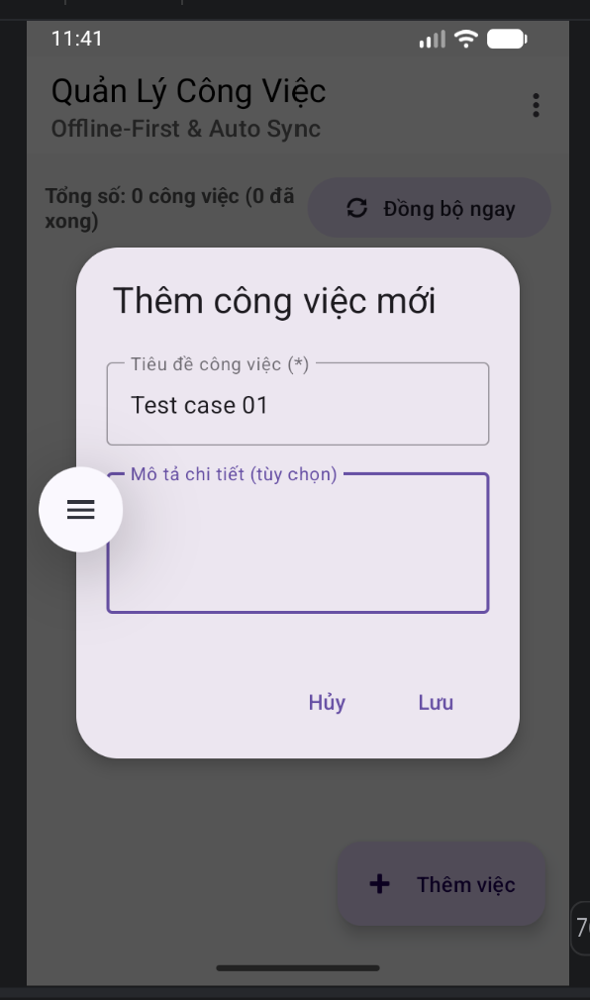

**Bản được tạo trên thiết bị**
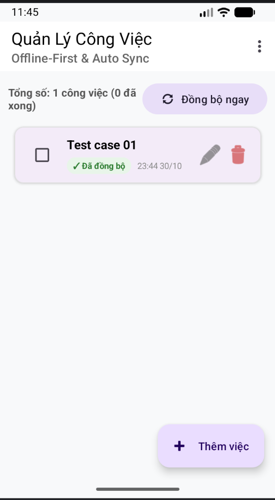

**Bản được tạo trên máy chủ**
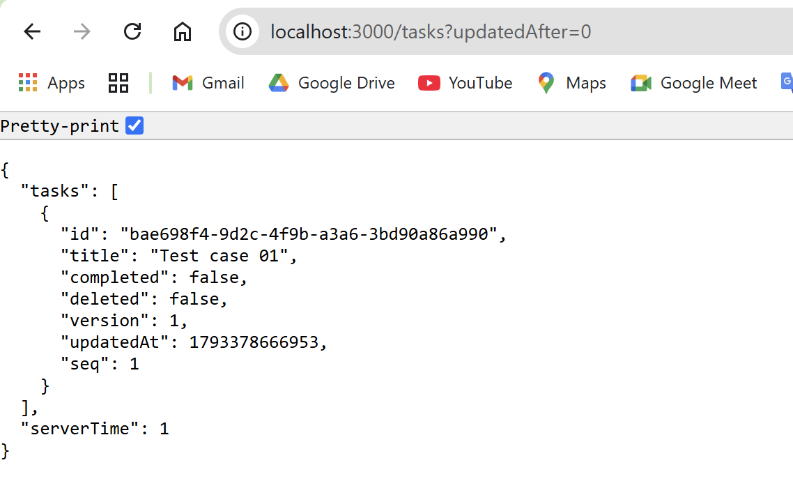

### 7.2. TC02 — Thao tác công việc khi ngoại tuyến

**Cách thực hiện:**
Tắt kết nối mạng trên A → thêm công việc → kiểm tra danh sách cùng trạng thái chờ đồng bộ.

**Kết quả mong đợi**:
Dữ liệu vẫn được lưu và hiển thị từ Room.

**Kết quả:** PASS theo xác nhận của người dùng. 

**Minh chứng:**

**Tạo task khi đang tắt wifi**
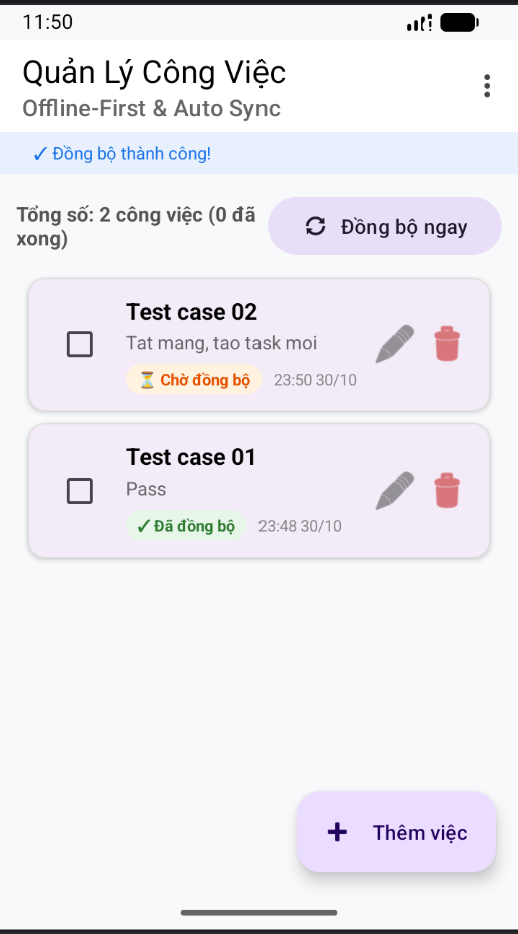

### 7.3. TC03 — Khôi phục kết nối mạng

**Cách thực hiện:**
Sau khi chỉnh sửa công việc offline trên A → bật lại mạng → chờ đồng bộ hoặc bấm Đồng bộ ngay → kiểm tra dữ liệu và trạng thái trên A.

**Kết quả:** PASS theo xác nhận của người dùng trong phạm vi một thiết bị. Chưa có thông tin phân biệt WorkManager tự chạy với kích hoạt thủ công, và chưa xác nhận B nhận đủ dữ liệu sau phục hồi.

**Minh chứng:**

**Sau khi bật lại wifi**
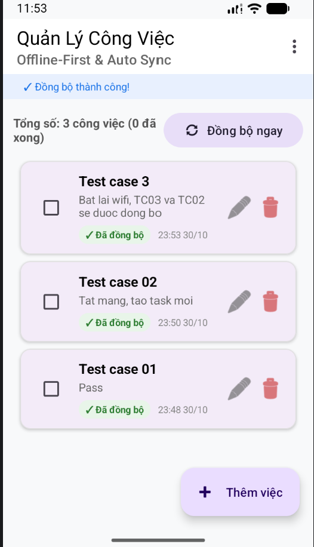
### 7.4. TC04 — Đóng ứng dụng rồi mở lại

**Cách thực hiện:

**Kết quả:** PASS 

**Kết quả mong đợi:** Ứng dụng không mất thay đổi; có cơ chế thử lại phù hợp.

**Minh chứng:**

**Tắt mạng tạo test case 04 **
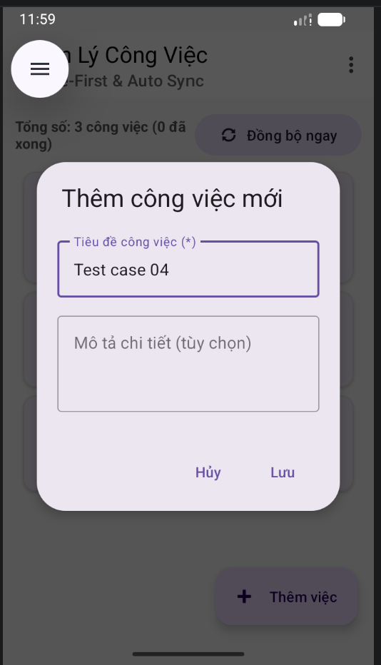

**Tắt app bật lại khi offline nhưng tc04 vẫn còn**
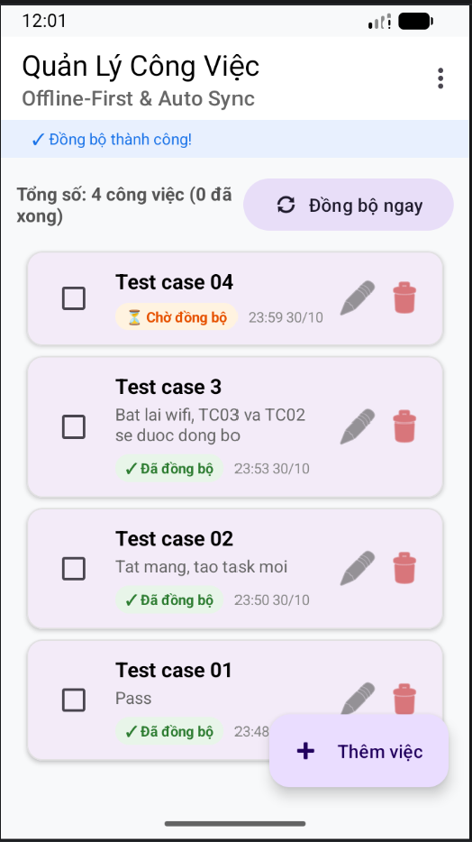

**Khi bật lại mạng thì tự động đồng bộ**
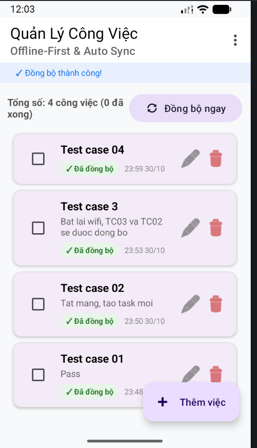

**Bản ghi xuất hiện trên server**
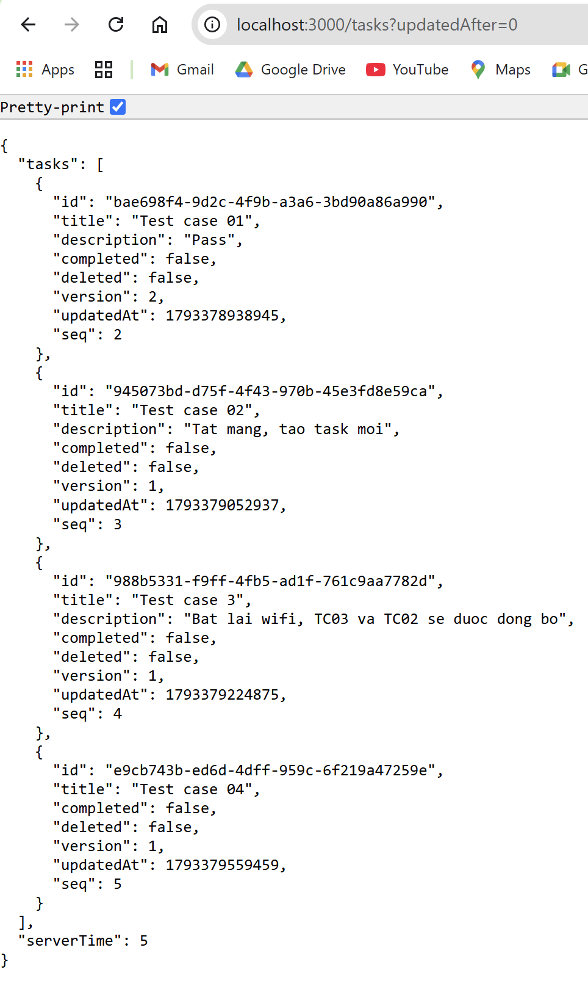

### 7.5. TC05 — Máy chủ tạm thời không phản hồi


**Cách thực hiện:**

**Kết quả:** PASS 

**Minh chứng:**

**Bật chậm 7 giây trong giả lập lỗi ở nút 3 chấm**
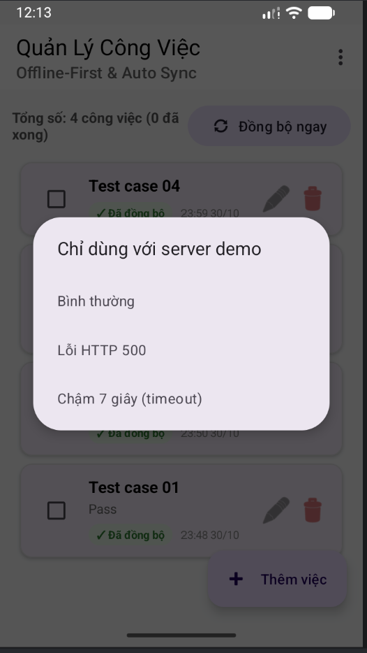

**Tạo task mới**
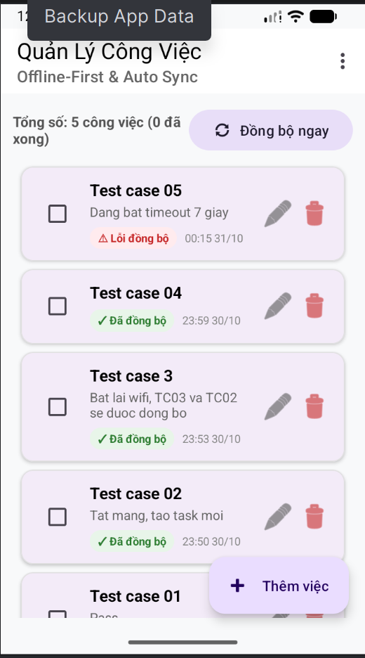

**app tự retry**
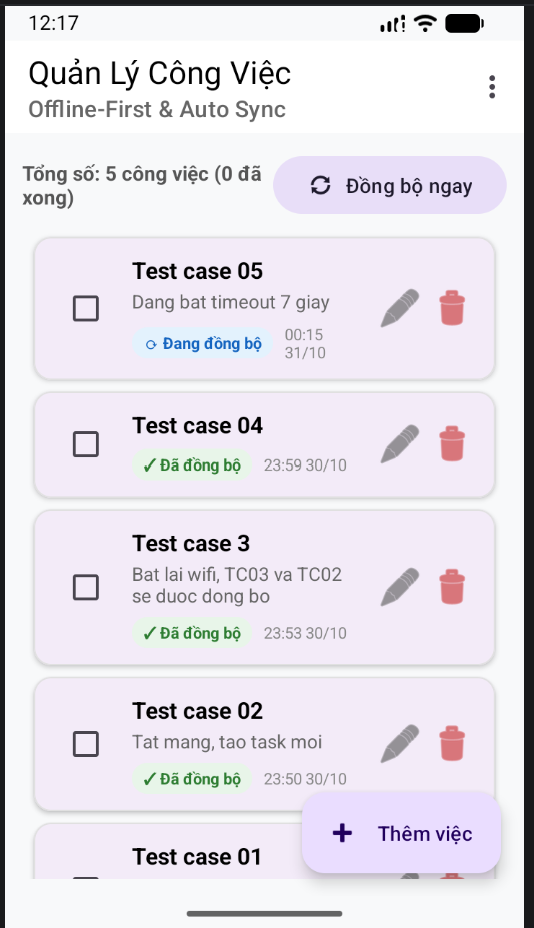

**Sau khi tắt timeout**
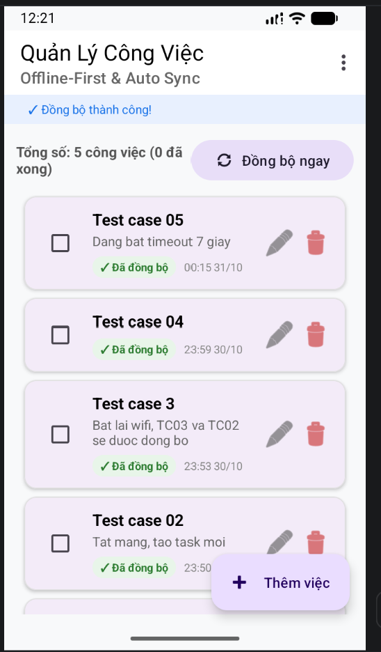

### 7.6. TC06 — Đồng bộ cùng một thay đổi nhiều lần

**Cách thực hiện:**
Tạo hoặc sửa một task → đồng bộ → không tạo task mới hay sửa nội dung nữa → bấm đồng bộ nhiều lần → đối chiếu ID, nội dung và số bản ghi trên app/server.

**Kết quả mong đợi:**
không tạo bản ghi trùng hoặc áp dụng thao tác ngoài ý muốn.

**Kết quả:** Chưa có kết quả xác nhận riêng trên Android. Test HTTP gửi lại đã PASS ở mục 4, nhưng không dùng thay kết quả end-to-end của ca này. Ảnh có hai task cùng tên chưa chứng minh trùng cùng ID.

**Minh chứng:**

**Tạo test case 06:**
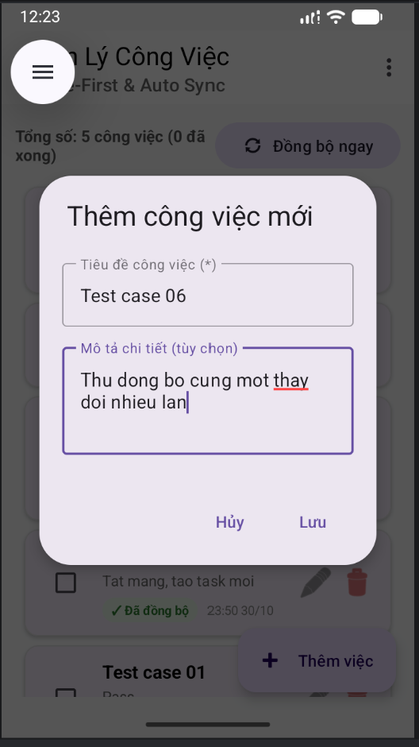

**Bản ghi trước khi đồng bộ nhiều lần**
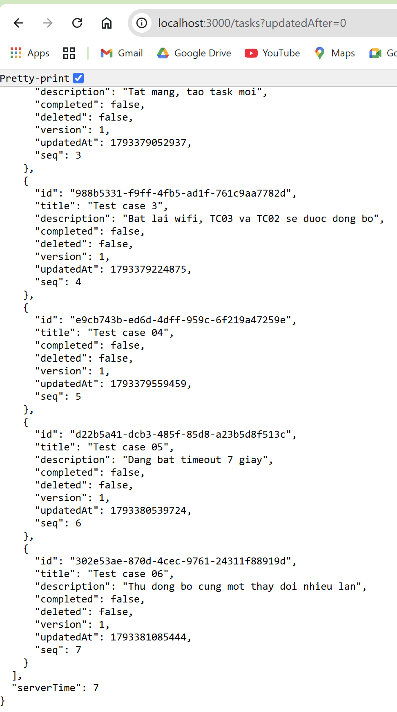

**Bản ghi sau khi đồng bộ nhiều lần**
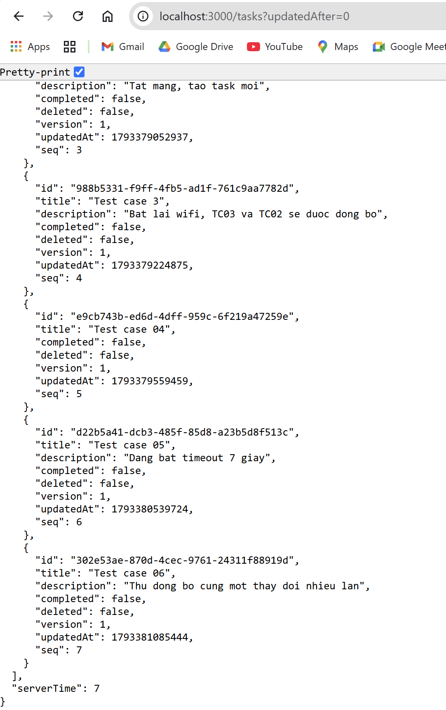
### 7.7. TC07 — Hai thiết bị sửa cùng một công việc

**Cách thực hiện:**
A tạo task và đồng bộ → B đồng bộ để nhận cùng ID → A offline và sửa task → B sửa chính task đó rồi đồng bộ → A có mạng lại và đồng bộ → B đồng bộ lại → so sánh kết quả với chính sách đã chọn. Không tạo hai task riêng chỉ có cùng tên.

**Kết quả:** CHƯA KẾT LUẬN. Ảnh người dùng cung cấp hiển thị Medium có 3 task, trong đó một “Test case 6”; Small có 4 task, trong đó hai “Test case 6” ở 17:35 và 17:36. Chưa đối chiếu UUID/version, dữ liệu server và thời điểm pull hoàn tất, nên chưa xác nhận nguyên nhân hoặc kết quả xử lý xung đột.

**Minh chứng:**
![TC06]

### 7.8. TC08 — Xóa công việc khi ngoại tuyến

**Cách thực hiện:**
Đồng bộ để A và server có cùng task → ngắt mạng A → xóa task trên A → bật mạng và đồng bộ → đồng bộ lại nhiều lần;

**Kết quả:** Chưa có kết quả xác nhận đầy đủ sau khi đồng bộ. PASS của thao tác xóa local ở TC02 không tự xác nhận task không bị tải trở lại trong TC08.

**Minh chứng:**

**Tạo test case 08 khi bật mạng**
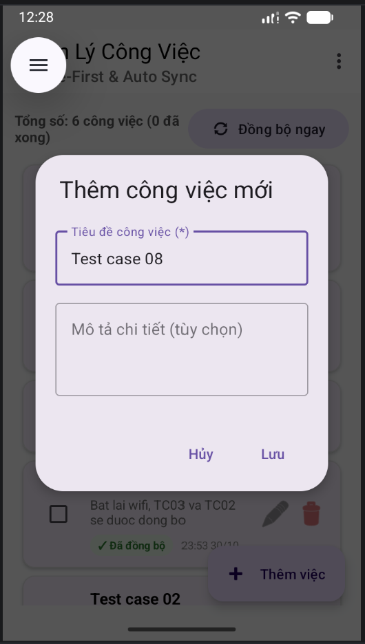

**Bản ghi trước khi xóa**
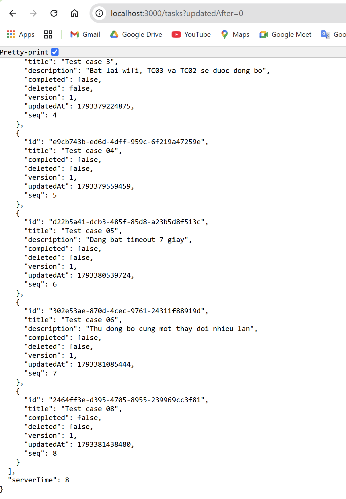

**Bản ghi sau khi xóa lúc tắt mạng**
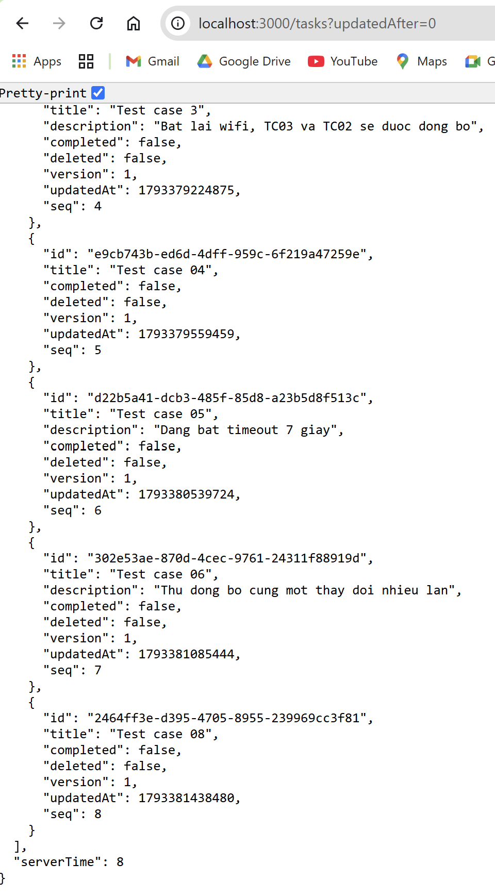

**Bản ghi sau khi bật lại wifi**
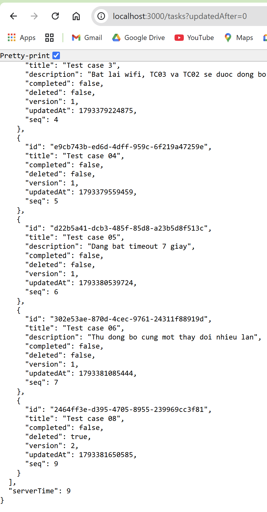

### 7.9. TC09 — Đồng bộ nhiều bản ghi

### 7.9. TC09 — Đồng bộ nhiều bản ghi

**Cách thực hiện:**

Sử dụng instrumentation test riêng [TC09SyncBenchmarkTest.kt](../app/src/androidTest/java/com/example/taskmanagerapp/TC09SyncBenchmarkTest.kt). Test chạy qua Room thật → TaskRepository → WorkManager thật → API server, không gọi trực tiếp SyncEngine hoặc giả lập response.

#### Chuẩn bị

- Dùng **một emulator dành cho kiểm thử**, chạy cùng code đang đo. Test tạo dữ liệu thật và để lại nhóm task có tiền tố `TC09-<thời gian>-<UUID>` để đối chiếu. Không chạy trên dữ liệu quan trọng.
- Khởi động server bằng `run.bat`/`run.sh`, giữ server chạy xuyên suốt lượt đo; tắt chaos và Demo Mock trước khi chạy.
- Hoàn tất các tác vụ cũ. Test kiểm tra không có task PENDING/FAILED/SYNCING và không có manual work đang chờ/chạy; nếu có thì ghi BLOCKED thay vì xóa hoặc hủy dữ liệu cũ.
- Không chỉnh sửa task, nhấn nút sync, bật lỗi hoặc chạy test khác trong lúc đo. Periodic work có sẵn không bị hủy; nếu nó chạy thì có thể tham gia đồng bộ và ảnh hưởng thời gian.
- Test không reset server, không xóa task, không đổi preferences hay code ứng dụng. Worker thật có thể cập nhật dữ liệu/prefs như một lượt sync bình thường. Nhóm task thử giữ lại sau chạy; các dữ liệu cũ trên server không được tính vào số lượng nhóm này.

#### Chạy test trên Windows

Mở Terminal tại `TaskManagerApp`, khởi động đúng một emulator. Ví dụ đo 10 task:

```powershell
.\gradlew.bat connectedDebugAndroidTest `
  "-Pandroid.testInstrumentationRunnerArguments.class=com.example.taskmanagerapp.TC09SyncBenchmarkTest" `
  "-Pandroid.testInstrumentationRunnerArguments.tc09Enabled=true" `
  "-Pandroid.testInstrumentationRunnerArguments.tc09N=10" `
  "-Pandroid.testInstrumentationRunnerArguments.tc09TimeoutSeconds=180" `
  --rerun-tasks --console=plain *> TC09_N10_gradle.log
$LASTEXITCODE
```

Đổi `tc09N` thành 50 hoặc 100 và đổi tên file log cho từng lượt. Cho các work cũ hoàn tất trước lượt tiếp theo; không cần xóa các task TC09 trước. Mỗi lượt có runId mới. Có thể chạy mỗi mức 3–5 lượt, không coi việc lặp lại là đã thực hiện nếu chưa chạy thực tế.

Các tham số:

| Tham số | Mặc định / giới hạn | Ý nghĩa |
| --- | --- | --- |
| tc09Enabled | Phải đặt true | Chủ động bật bài đo; thiếu tham số thì test SKIPPED để bộ test thông thường không tự tạo task/gọi server |
| tc09N | 10; từ 1 đến 100 | Số task tạo trong một lượt |
| tc09TimeoutSeconds | 180; từ 30 đến 600 | Hạn chờ tính từ trước lúc bắt đầu tạo task; GET/poll đang chờ có thể khiến thời gian thoát thực tế vượt hạn một chút |

Nếu chạy bằng nút Run test trong Android Studio, cần đặt instrumentation runner arguments tương ứng; chạy không có `tc09Enabled=true` chỉ cho kết quả SKIPPED, không phải PASS.

#### Quy trình đo và tiêu chí

1. Kiểm tra điều kiện và gọi GET server trước đo.
2. Ghi mốc monotonic ngay trước task đầu tiên; tạo N task qua `repository.insertTask()`. Repository tự xếp manual work sau mỗi task; test xếp thêm một lượt sync sau khi tạo xong.
3. Mỗi khoảng 1 giây đọc Room, trạng thái work và GET server; GET có thể chờ tối đa theo timeout HTTP của app. Test chỉ xét nhóm runId hiện tại.
4. Đạt khi đủ N task có nội dung đúng, Room SYNCED, version server dương và khớp Room, updatedAt khớp, không trùng ID/thiếu/thừa, và các manual work mới quan sát được đều SUCCEEDED.
5. Ghi SUMMARY và chi tiết TASK, giữ dữ liệu để đối chiếu. Hết thời gian hoặc có lỗi không được coi là PASS.

`completedMs` gồm **tạo Room, xếp hàng WorkManager, HTTP push/pull và polling kiểm chứng**; không phải thời gian network thuần. Sai số quan sát còn phụ thuộc chu kỳ polling và thời gian GET. Các GET kiểm chứng cũng tạo thêm tải server.

**Tỷ lệ xác nhận task** = `verified / requested × 100%`. Một task chỉ verified khi có cả local/server đúng nội dung, trạng thái và version/thời gian tương ứng. Tỷ lệ task có thể đạt 100% nhưng cả lượt vẫn FAIL nếu work chưa kết thúc, có task thừa hoặc ID trùng; luôn đọc cùng trường `status`.

#### cách Lấy log

Test ghi cùng nội dung JSON Lines vào Logcat tag **TC09** và file private:

```text
/data/user/0/com.example.taskmanagerapp/files/tc09_logs/<runId>.jsonl
```

Đường dẫn thực tế được in ở `TC09_LOG_FILE` trong output test. Logcat có các event START, PREFLIGHT_OK, CREATED, PROGRESS, TASK và SUMMARY. File lưu đầy đủ từng dòng; ưu tiên file khi Logcat bị cắt/buffer ghi đè.

Trong Android Studio mở Logcat, chọn emulator và lọc:

```text
tag:TC09
```

Lọc SUMMARY từ file đã lấy:

```powershell
Get-Content .\TC09_N10_L1.jsonl |
  ForEach-Object { $_ | ConvertFrom-Json } |
  Where-Object { $_.event -eq 'SUMMARY' } |
  Format-List
```

Dán nguyên dòng SUMMARY vào phần Minh chứng cùng runId, N, commit và emulator. TASK chứa expected/local/server để kiểm tra từng ID. `duplicateIds` là số ID lặp trong response server của nhóm; `mismatchedIds` tính ID thiếu/thừa hoặc task chưa khớp/được xác nhận. Hai trường này là null nếu chưa có snapshot kiểm chứng thành công, không được đổi null thành 0.

| Trường log | Cách đọc |
| --- | --- |
| status | PASS: đạt toàn bộ điều kiện; FAIL: bắt đầu đo nhưng chưa đạt/lỗi; BLOCKED: điều kiện trước đo không đạt |
| requested / created / verified | N yêu cầu / số insert hoàn tất / số task đã xác nhận đúng ở snapshot GET thành công gần nhất |
| insertionMs | Thời gian tạo nhóm task qua repository |
| completedMs | Thời gian hoàn tất đã kiểm chứng; null nếu không hoàn tất |
| observedElapsedMs | Thời gian quan sát đến khi kết thúc, không phải thời gian hoàn tất nếu test FAIL |
| successRatePercent | Tỷ lệ task verified, không phải tỷ lệ số lượt test thành công |
| workStates | Trạng thái các manual work mới quan sát được |
| lastObservation / error | Lần kiểm tra cuối và lý do nếu chưa đạt |

Báo cáo HTML instrumentation ở `app/build/reports/androidTests/connected/` cũng ghi pass/fail của bài test. Giá trị status BLOCKED được ghi trong JSON nhưng JUnit nhận assertion không đạt để tránh runner báo PASS giả; trường hợp opt-in chưa bật thì runner SKIPPED. Không dùng riêng chữ BUILD SUCCESSFUL để suy ra bài TC09 đã thực sự chạy.

**Kết quả:** Chưa có kết quả thực thi bài test Android này. Mã kiểm thử mới được thêm; không thay số liệu HTTP trong cloud thành số liệu Android và không tự điền PASS. Sau khi chạy, điền từng lượt theo log:

| N task | Lượt / runId | completedMs | verified/requested | successRatePercent | duplicateIds | mismatchedIds | status |
| --- | --- | --- | --- | --- | --- | --- | --- |
| | | | | | | | |

**Minh chứng:**
2026-10-31 01:14:21.779 12115-12142 TC09
com.example.taskmanagerapp           I  
{"event":"SUMMARY","runId":"TC09-1793384058344-3f575532-3bc5-4ee4-848c-93251ed42727","timestampMs":1793384061779,"status":"PASS","requested":10,"created":10,"verified":10,"successRatePercent":100,"completedMs":2493,"observedElapsedMs":2508,"insertionMs":131,"duplicateIds":0,"mismatchedIds":0,"workStates":"{SUCCEEDED=11}","lastObservation":"GET OK; expected=10 local=10 server=10","error":null,"scope":"Only this runId group; no two-device or UI measurement"}