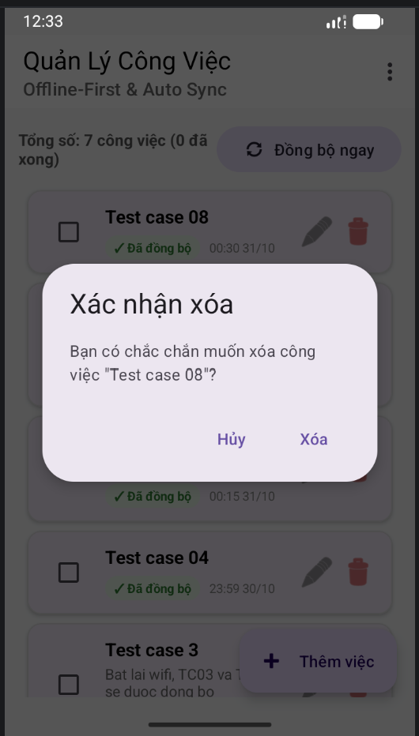

# D6. Bộ kiểm thử và kết quả kiểm thử

- **Dự án:** Android Auto Sync – TaskManagerApp.
- **Người biên soạn:** PeterKhang3012.

# D6. Bộ kiểm thử và kết quả kiểm thử

## 1. Trạng thái build và test Android

### 1.1. Unit test trên Windows — PASS

Nguồn: HTML “Gradle Test Run :app:testDebugUnitTest”, tạo bởi Gradle 9.6.0.

| Lớp test | Số test | Fail | Skipped | Thời lượng theo báo cáo | Kết quả |
| --- | --- | --- | --- | --- | --- |
| ExampleUnitTest | 1 | 0 | 0 | 0.009 s | PASS; test mẫu |
| ConflictResolverTest | 2 | 0 | 0 | 0.002 s | PASS |
| Tổng theo trang summary | 3 | 0 | 0 | 0.976 s | 100% thành công |

Trích xuất báo cáo HTML:

```text
Task: :app:testDebugUnitTest
Tests: 3
Failures: 0
Skipped: 0
Duration: 0.976s
Successful: 100%
ExampleUnitTest: 1 test
ConflictResolverTest: 2 tests
```

### 1.2. Instrumented test — PASS theo báo cáo tổng hợp

Nguồn: HTML “Test Summary”, tạo bởi Gradle 9.6.0 

| Lớp test | Số lượt báo cáo | Fail | Skipped | Thời lượng | Kết quả |
| --- | --- | --- | --- | --- | --- |
| ExampleInstrumentedTest | 2 | 0 | 0 | 0.054 s | PASS; test mẫu |
| TaskDaoTest | 8 | 0 | 0 | 0.046 s | PASS |
| Tổng | 10 | 0 | 0 | 0.100 s | 100% thành công |

Trích xuất từ HTML:

```text
Tests: 10
Failures: 0
Skipped: 0
Duration: 0.100s
Successful: 100%
ExampleInstrumentedTest: 2
TaskDaoTest: 8
```

Source đối chiếu có 4 phương thức test DAO và 1 test instrumented mẫu. Log thực thi bổ sung xác nhận 5 test chạy trên mỗi emulator:

```text
Starting 5 tests on Small_Phone(AVD) - 17
Finished 5 tests on Small_Phone(AVD) - 17
Starting 5 tests on Medium_Phone(AVD) - 17
Finished 5 tests on Medium_Phone(AVD) - 17
BUILD SUCCESSFUL in 50s
```

Báo cáo tổng hợp là 10 lượt thực thi, không phải 10 test case khác nhau. Ký hiệu `- 17` được giữ nguyên từ log; không dùng nó thay API 37.0 hiển thị trong Device Manager. Thời gian 50 giây gồm build và chạy test, không phải thời gian đồng bộ.

## 2. Test cases Android

Mỗi ca trình bày thống nhất: **Cách thực hiện → Kết quả mong đợi → Kết quả → Minh chứng**. Kết quả được phân biệt theo xác nhận thủ công, ảnh đối chiếu hoặc test tự động. 

| Mã | Kịch bản | Kết quả hiện có |
| --- | --- | --- |
| TC01 | Tạo công việc khi có Internet | PASS — xác nhận thủ công và ảnh app/server |
| TC02 | Thao tác công việc ngoại tuyến | PASS — xác nhận thủ công và ảnh |
| TC03 | Khôi phục kết nối mạng | PASS trong phạm vi một thiết bị; chưa xác nhận truyền sang B |
| TC04 | Đóng ứng dụng rồi mở lại | PASS qua kiểm thử thủ công và chuỗi ảnh; không bao gồm reboot/force-stop |
| TC05 | Máy chủ tạm thời không phản hồi | PASS theo xác nhận thủ công; ảnh không đo được chính xác lịch backoff |
| TC06 | Đồng bộ cùng một thay đổi nhiều lần | PASS trong lượt đối chiếu trước/sau đã cung cấp |
| TC07 | Hai thiết bị sửa cùng một công việc | CHƯA KẾT LUẬN |
| TC08 | Xóa công việc khi ngoại tuyến | Đã xác nhận truyền dấu xóa; chưa đủ minh chứng không tải lại sau các lần sync tiếp |
| TC09 | Đồng bộ nhiều bản ghi | PASS — một lượt 10 task trên Small Phone |

### 2.1. TC01 — Tạo công việc khi có Internet

**Cách thực hiện:**

A có Internet → thêm task → sửa → đánh dấu hoàn thành → đồng bộ.

**Kết quả mong đợi:**

Dữ liệu xuất hiện trên thiết bị và máy chủ.

**Kết quả:** PASS.

**Minh chứng:**

**Tạo test case 01**


**Bản được tạo trên thiết bị**


**Bản được tạo trên máy chủ**


### 2.2. TC02 — Thao tác công việc khi ngoại tuyến

**Cách thực hiện:**

Tắt kết nối mạng trên A → thêm công việc → kiểm tra danh sách cùng trạng thái chờ đồng bộ.

**Kết quả mong đợi:**

Dữ liệu vẫn được lưu và hiển thị từ Room.

**Kết quả:** PASS qua kiểm thử thủ công.

**Minh chứng:**

**Tạo task khi đang tắt wifi**


### 2.3. TC03 — Khôi phục kết nối mạng

**Cách thực hiện:**

Sau khi chỉnh sửa công việc offline trên A → bật lại mạng → chờ đồng bộ hoặc bấm Đồng bộ ngay → kiểm tra dữ liệu và trạng thái trên A.

**Kết quả mong đợi:**

Thay đổi đã lưu khi offline được gửi lên server sau khi có mạng; nội dung được giữ đúng và trạng thái được cập nhật sau xác nhận.

**Kết quả:** PASS trong phạm vi kiểm thử một thiết bị. Chưa có thông tin phân biệt WorkManager tự chạy với kích hoạt thủ công, và chưa xác nhận B nhận đủ dữ liệu sau phục hồi.

**Minh chứng:**

**Sau khi bật lại wifi**


### 2.4. TC04 — Đóng ứng dụng rồi mở lại

**Cách thực hiện:**

Tắt mạng A → tạo task → đóng giao diện ứng dụng và mở lại khi vẫn offline → kiểm tra task còn nguyên → bật lại mạng, để tác vụ đồng bộ tiếp tục → kiểm tra trạng thái và bản ghi trên server.

**Kết quả mong đợi:**

Dữ liệu cục bộ vẫn còn; tác vụ đồng bộ tiếp tục theo cơ chế đã thiết kế khi điều kiện cho phép.

**Kết quả:** PASS qua kiểm thử thủ công. Chuỗi ảnh thể hiện task còn sau mở lại offline, sau đó được đồng bộ và xuất hiện trên server với ID `e9cb743b-ed6d-4dff-959c-6f219a47259e`. Không suy rộng kết quả này thành kiểm thử reboot hoặc Force stop.

**Minh chứng:**

**Tạo task TC04 khi tắt mạng**


**Tắt app bật lại khi offline nhưng tc04 vẫn còn**


**Khi bật lại mạng thì tự động đồng bộ**


**Bản ghi xuất hiện trên server**


### 2.5. TC05 — Máy chủ tạm thời không phản hồi

**Cách thực hiện:**

Giữ server chạy → bật độ trễ 7000 ms trong menu giả lập → tạo/sửa task và kích hoạt đồng bộ với read timeout 5 giây → quan sát trạng thái xử lý → tắt độ trễ, giữ mạng bật và để tác vụ thử lại → kiểm tra task được xác nhận sau phục hồi.

**Kết quả mong đợi:**

Ứng dụng không mất thay đổi; có cơ chế thử lại phù hợp khi máy chủ phản hồi trở lại. Không tạo thêm task ngoài ý muốn do gửi lại.

**Kết quả:** PASS qua kiểm thử thủ công và chuỗi ảnh timeout/phục hồi. Ảnh `TC05_app_tu_retry.png` thể hiện trạng thái “Đang đồng bộ”, không tự chứng minh chính xác thời điểm timeout hay khoảng backoff. Không có số đo lịch retry riêng trong ca này.

**Minh chứng:**

**Bật chậm 7 giây trong giả lập lỗi ở nút 3 chấm**


**Tạo task mới**


**Trạng thái đồng bộ trong lúc thử lại**


**Sau khi tắt timeout**


### 2.6. TC06 — Đồng bộ cùng một thay đổi nhiều lần

**Cách thực hiện:**

Tạo hoặc sửa một task → đồng bộ → không tạo task mới hay sửa nội dung nữa → bấm đồng bộ nhiều lần → đối chiếu ID, nội dung và số bản ghi trên app/server.

**Kết quả mong đợi:**

Không tạo bản ghi trùng hoặc áp dụng thao tác ngoài ý muốn.

**Kết quả:** PASS trong tình huống đồng bộ lặp không thay đổi nội dung theo cặp ảnh trước/sau trên Git. Task `Test case 06` giữ nguyên ID `302e53ae-870d-4cec-9761-24311f88919d`, description `Thu dong bo cung mot thay doi nhieu lan`, completed=false, deleted=false, version=1, updatedAt=1793381085444 và seq=7; cursor serverTime vẫn bằng 7. Không thấy tác dụng phụ lên bản ghi được đối chiếu. Ảnh không xác định số lần bấm và không thay thế thử mất phản hồi rồi retry.

**Minh chứng:**

**Tạo test case 06:**


**Bản ghi trước khi đồng bộ nhiều lần**


**Bản ghi sau khi đồng bộ nhiều lần**


### 2.7. TC07 — Hai thiết bị sửa cùng một công việc

**Cách thực hiện:**

A tạo task và đồng bộ → B đồng bộ để nhận cùng ID → A offline và sửa task → B sửa chính task đó rồi đồng bộ → A có mạng lại và đồng bộ → B đồng bộ lại → so sánh kết quả với chính sách đã chọn. Không tạo hai task riêng chỉ có cùng tên.

**Kết quả mong đợi:**

Hệ thống phát hiện và xử lý xung đột theo chính sách đã công bố; hai thiết bị nhận được kết quả phù hợp khi đồng bộ.

**Kết quả:** CHƯA KẾT LUẬN. Ảnh minh chứng hiển thị Medium có 3 task, trong đó một “Test case 6”; Small có 4 task, trong đó hai “Test case 6” ở 17:35 và 17:36. Chưa đối chiếu UUID/version, dữ liệu server và thời điểm pull hoàn tất, nên chưa xác nhận nguyên nhân hoặc kết quả xử lý xung đột.

**Minh chứng:**

Chưa có ảnh hoặc log đầy đủ cho ca hai thiết bị sửa cùng ID.

### 2.8. TC08 — Xóa công việc khi ngoại tuyến

**Cách thực hiện:**

Đồng bộ để A và server có cùng task → ngắt mạng A → xóa task trên A → bật mạng và đồng bộ → đồng bộ lại nhiều lần;

**Kết quả mong đợi:**

Bản ghi đã xóa không bị tải trở lại ngoài ý muốn sau khi đồng bộ.

**Kết quả:** Đã xác nhận bước truyền xóa mềm: cùng ID `2464ff3e-d395-4705-8955-239969cc3f81` chuyển từ deleted=false, version=1, seq=8 sang deleted=true, version=2, seq=9 sau khi bật mạng. Ảnh server xác nhận tombstone, không phải xóa cứng. Chưa có ảnh/kết quả riêng về các lượt sync hoặc mở lại app sau đó để khẳng định đầy đủ điều kiện “không bị tải trở lại”; chưa đánh dấu toàn ca PASS.

**Minh chứng:**

**Tạo test case 08 khi bật mạng**


**Bản ghi trước khi xóa**


**Xóa task trên app khi đang offline**



**Bản ghi server sau khi xóa lúc offline**


**Bản ghi sau khi bật lại wifi**


### 2.9. TC09 — Đồng bộ nhiều bản ghi

**Cách thực hiện:**

Sử dụng instrumentation test riêng [TC09SyncBenchmarkTest.kt](../app/src/androidTest/java/com/example/taskmanagerapp/TC09SyncBenchmarkTest.kt). Test chạy qua Room thật → TaskRepository → WorkManager thật → API server, không gọi trực tiếp SyncEngine hoặc giả lập response.

**Kết quả mong đợi:**

Có số liệu về thời gian xử lý, tỷ lệ thành công và tính nhất quán của nhóm task; kết quả có log đối chiếu.

#### Chuẩn bị

- Dùng **một emulator dành cho kiểm thử**, chạy cùng code đang đo. Test tạo dữ liệu thật và để lại nhóm task có tiền tố `TC09-<thời gian>-<UUID>` để đối chiếu. Không chạy trên dữ liệu quan trọng.
- Khởi động server bằng `run.bat`/`run.sh`, giữ server chạy xuyên suốt lượt đo; tắt chaos và Demo Mock trước khi chạy.
- Hoàn tất các tác vụ cũ. Test kiểm tra không có task PENDING/FAILED/SYNCING và không có manual work đang chờ/chạy; nếu có thì ghi BLOCKED thay vì xóa hoặc hủy dữ liệu cũ.
- Không chỉnh sửa task, nhấn nút sync, bật lỗi hoặc chạy test khác trong lúc đo. Periodic work có sẵn không bị hủy; nếu nó chạy thì có thể tham gia đồng bộ và ảnh hưởng thời gian.
- Test không reset server, không xóa task, không đổi preferences hay code ứng dụng. Worker thật có thể cập nhật dữ liệu/prefs như một lượt sync bình thường. Nhóm task thử giữ lại sau chạy; các dữ liệu cũ trên server không được tính vào số lượng nhóm này.

#### Chạy test trên Windows

Mở Terminal tại `TaskManagerApp`, khởi động đúng một emulator. Ví dụ đo 10 task:

```powershell
.\gradlew.bat connectedDebugAndroidTest `
  "-Pandroid.testInstrumentationRunnerArguments.class=com.example.taskmanagerapp.TC09SyncBenchmarkTest" `
  "-Pandroid.testInstrumentationRunnerArguments.tc09Enabled=true" `
  "-Pandroid.testInstrumentationRunnerArguments.tc09N=10" `
  "-Pandroid.testInstrumentationRunnerArguments.tc09TimeoutSeconds=180" `
  --rerun-tasks --console=plain *> TC09_N10_gradle.log
$LASTEXITCODE
```

Đổi `tc09N` thành 50 hoặc 100 và đổi tên file log cho từng lượt. Cho các work cũ hoàn tất trước lượt tiếp theo; không cần xóa các task TC09 trước. Mỗi lượt có runId mới. Có thể chạy mỗi mức 3–5 lượt, không coi việc lặp lại là đã thực hiện nếu chưa chạy thực tế.

Các tham số:

| Tham số | Mặc định / giới hạn | Ý nghĩa |
| --- | --- | --- |
| tc09Enabled | Phải đặt true | Chủ động bật bài đo; thiếu tham số thì test SKIPPED để bộ test thông thường không tự tạo task/gọi server |
| tc09N | 10; từ 1 đến 100 | Số task tạo trong một lượt |
| tc09TimeoutSeconds | 180; từ 30 đến 600 | Hạn chờ tính từ trước lúc bắt đầu tạo task; GET/poll đang chờ có thể khiến thời gian thoát thực tế vượt hạn một chút |

Nếu chạy bằng nút Run test trong Android Studio, cần đặt instrumentation runner arguments tương ứng; chạy không có `tc09Enabled=true` chỉ cho kết quả SKIPPED, không phải PASS.

#### Quy trình đo và tiêu chí

1. Kiểm tra điều kiện và gọi GET server trước đo.
2. Ghi mốc monotonic ngay trước task đầu tiên; tạo N task qua `repository.insertTask()`. Repository tự xếp manual work sau mỗi task; test xếp thêm một lượt sync sau khi tạo xong.
3. Mỗi khoảng 1 giây đọc Room, trạng thái work và GET server; GET có thể chờ tối đa theo timeout HTTP của app. Test chỉ xét nhóm runId hiện tại.
4. Đạt khi đủ N task có nội dung đúng, Room SYNCED, version server dương và khớp Room, updatedAt khớp, không trùng ID/thiếu/thừa, và các manual work mới quan sát được đều SUCCEEDED.
5. Ghi SUMMARY và chi tiết TASK, giữ dữ liệu để đối chiếu. Hết thời gian hoặc có lỗi không được coi là PASS.

`completedMs` gồm **tạo Room, xếp hàng WorkManager, HTTP push/pull và polling kiểm chứng**; không phải thời gian network thuần. Sai số quan sát còn phụ thuộc chu kỳ polling và thời gian GET. Các GET kiểm chứng cũng tạo thêm tải server.

**Tỷ lệ xác nhận task** = `verified / requested × 100%`. Một task chỉ verified khi có cả local/server đúng nội dung, trạng thái và version/thời gian tương ứng. Tỷ lệ task có thể đạt 100% nhưng cả lượt vẫn FAIL nếu work chưa kết thúc, có task thừa hoặc ID trùng; luôn đọc cùng trường `status`.

#### Lấy log làm minh chứng

Test ghi cùng nội dung JSON Lines vào Logcat tag **TC09** và file private:

```text
/data/user/0/com.example.taskmanagerapp/files/tc09_logs/<runId>.jsonl
```

Đường dẫn thực tế được in ở `TC09_LOG_FILE` trong output test. Logcat có các event START, PREFLIGHT_OK, CREATED, PROGRESS, TASK và SUMMARY. File lưu đầy đủ từng dòng; ưu tiên file khi Logcat bị cắt/buffer ghi đè.

Trong Android Studio mở Logcat, chọn emulator và lọc:

```text
tag:TC09
```

Để lấy log bằng adb, dùng Terminal có adb trong PATH; hoặc Terminal tại thư mục `platform-tools` trong Android SDK. Nếu PowerShell đứng ngay tại platform-tools mà adb chưa ở PATH, thay `adb` bằng `.\adb.exe`.

```powershell
adb devices
adb -s emulator-5554 logcat -d -s TC09:I '*:S' > TC09_logcat.txt
adb -s emulator-5554 shell run-as com.example.taskmanagerapp ls files/tc09_logs
```

Thay `emulator-5554` bằng serial thiết bị thực tế. Sau lệnh `ls`, lấy đúng tên JSONL của lượt cần lưu rồi chạy (thay `TEN_FILE.jsonl` bằng tên thật):

```powershell
adb -s emulator-5554 exec-out run-as com.example.taskmanagerapp cat files/tc09_logs/TEN_FILE.jsonl > TC09_N10_L1.jsonl
```

App debug cho phép `run-as`. Nếu không dùng adb, mở **Device Explorer** trong Android Studio → tìm file trong `data/data/com.example.taskmanagerapp/files/tc09_logs` và lưu về máy. Không uninstall hoặc clear storage trước khi lấy file vì log private sẽ bị xóa cùng dữ liệu app.

Lọc SUMMARY từ file đã lấy:

```powershell
Get-Content .\TC09_N10_L1.jsonl |
  ForEach-Object { $_ | ConvertFrom-Json } |
  Where-Object { $_.event -eq 'SUMMARY' } |
  Format-List
```

Dán nguyên dòng SUMMARY vào phần Minh chứng cùng runId, N, commit và emulator. TASK chứa expected/local/server để kiểm tra từng ID. `duplicateIds` là số ID lặp trong response server của nhóm; `mismatchedIds` tính ID thiếu/thừa hoặc task chưa khớp/được xác nhận. Hai trường này là null nếu chưa có snapshot kiểm chứng thành công, không được đổi null thành 0.

| Trường log | Cách đọc |
| --- | --- |
| status | PASS: đạt toàn bộ điều kiện; FAIL: bắt đầu đo nhưng chưa đạt/lỗi; BLOCKED: điều kiện trước đo không đạt |
| requested / created / verified | N yêu cầu / số insert hoàn tất / số task đã xác nhận đúng ở snapshot GET thành công gần nhất |
| insertionMs | Thời gian tạo nhóm task qua repository |
| completedMs | Thời gian hoàn tất đã kiểm chứng; null nếu không hoàn tất |
| observedElapsedMs | Thời gian quan sát đến khi kết thúc, không phải thời gian hoàn tất nếu test FAIL |
| successRatePercent | Tỷ lệ task verified, không phải tỷ lệ số lượt test thành công |
| workStates | Trạng thái các manual work mới quan sát được |
| lastObservation / error | Lần kiểm tra cuối và lý do nếu chưa đạt |

Báo cáo HTML instrumentation ở `app/build/reports/androidTests/connected/` cũng ghi pass/fail của bài test. Giá trị status BLOCKED được ghi trong JSON nhưng JUnit nhận assertion không đạt để tránh runner báo PASS giả; trường hợp opt-in chưa bật thì runner SKIPPED. Không dùng riêng chữ BUILD SUCCESSFUL để suy ra bài TC09 đã thực sự chạy.

**Kết quả:** PASS cho một lượt kiểm thử với 10 task trên Small Phone, được ghi nhận trong báo cáo HTML và log SUMMARY. Cả 10 task đã được tạo và xác nhận đúng trên Room/server; tỷ lệ xác nhận 100%, không ghi nhận ID trùng hoặc ID/nội dung lệch trong nhóm thử.

| N task | Lượt / runId | completedMs | verified/requested | successRatePercent | duplicateIds | mismatchedIds | status |
| --- | --- | --- | --- | --- | --- | --- | --- |
| 10 | TC09-1793384058344-3f575532-3bc5-4ee4-848c-93251ed42727 | 2493 | 10/10 | 100% | 0 | 0 | PASS |

- Thời gian hoàn tất kiểm chứng: **2493 ms (2.493 giây)**, gồm tạo dữ liệu, chờ WorkManager, đồng bộ và polling kiểm chứng; không phải thời gian HTTP thuần.
- Thời gian tạo dữ liệu: **131 ms**. Thời gian quan sát đến cuối bài đo: **2508 ms**.
- Work quan sát được: **11 SUCCEEDED**, phù hợp 10 việc tự xếp khi insert và một việc test xếp thêm sau khi tạo xong.
- Báo cáo HTML xác nhận **1 test, 0 failures, 0 skipped**, thời lượng toàn test **3.572 giây**. Thời lượng toàn test khác `completedMs` do gồm các bước ngoài vùng đo.
- Kết quả chỉ áp dụng nhóm runId này trong một lượt 10 task; chưa có số đo cho 50/100 task hoặc đồng bộ hai thiết bị. Commit của lượt thực nghiệm chưa được ghi nhận.

**Minh chứng:**

Logcat tag `TC09`, lúc **01:14:21.779 ngày 31/10/2026** theo thời gian hiển thị trong log. JSON SUMMARY được giữ nguyên giá trị:

```json
{
  "event": "SUMMARY",
  "runId": "TC09-1793384058344-3f575532-3bc5-4ee4-848c-93251ed42727",
  "timestampMs": 1793384061779,
  "status": "PASS",
  "requested": 10,
  "created": 10,
  "verified": 10,
  "successRatePercent": 100,
  "completedMs": 2493,
  "observedElapsedMs": 2508,
  "insertionMs": 131,
  "duplicateIds": 0,
  "mismatchedIds": 0,
  "workStates": "{SUCCEEDED=11}",
  "lastObservation": "GET OK; expected=10 local=10 server=10",
  "error": null,
  "scope": "Only this runId group; no two-device or UI measurement"
}
```

Báo cáo HTML lớp `com.example.taskmanagerapp.TC09SyncBenchmarkTest`, tạo bởi Gradle 9.6.0 lúc **01:14:23 ngày 31/10/2026** theo thời gian ghi trong báo cáo:

```text
Tests: 1
Failures: 0
Skipped: 0
Duration: 3.572s
Successful: 100%
```

Log SUMMARY đã có trong tài liệu trên Git và được định dạng JSON ở trên; số liệu được đối chiếu với báo cáo HTML. Chưa có ảnh TC09 hoặc file HTML/JSONL gốc trong thư mục minh chứng trên Git.

